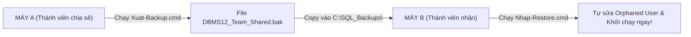

# DBMS12 EnglishCenter — Hệ thống Quản trị Trung tâm Anh ngữ

> **Đồ án môn học:** Hệ quản trị Cơ sở dữ liệu (Microsoft SQL Server)  
> **Kiến trúc dữ liệu:** 12 Bảng chuẩn hóa 3NF | 61 Stored Procedures tự quản lý Transaction (D15) | 7 Database Roles theo mô hình Native Security V2 (D14) | 12 Triggers | 9 Views | 7 Functions | 17 Explicit Indexes.  
> **Ngăn xếp công nghệ:** Backend ASP.NET Core (.NET 10 SDK) — Frontend React / TypeScript — SQL thuần có tham số (Không sử dụng ORM / EF Core).

---

## 📌 1. Giới thiệu tổng quan

**DBMS12 EnglishCenter** là hệ thống quản trị trung tâm đào tạo tiếng Anh khép kín, được thiết kế chuyên biệt để giải quyết các bài toán kỹ thuật nâng cao trên Microsoft SQL Server:
- **Chuẩn hóa dữ liệu 3NF:** Mô hình 12 bảng và 99 thuộc tính, loại bỏ hoàn toàn dư thừa dữ liệu và dị thường cập nhật.
- **Phân quyền thực tế (Native Security V2 - D14):** Khởi tạo 7 Database Roles và 7 Users (`WITHOUT LOGIN`). Toàn bộ bảng bị `DENY` truy cập trực tiếp; mọi thao tác đọc/ghi bắt buộc thông qua Stored Procedures và Views. Backend sử dụng cơ chế `EXECUTE AS` sau khi xác thực phiên người dùng.
- **Giao dịch ACID trong T-SQL (D15):** Toàn bộ 61 Stored Procedures tự kiểm soát khối `TRY...CATCH`, `SET XACT_ABORT ON` và điều phối `BEGIN/COMMIT/ROLLBACK TRANSACTION` linh hoạt theo độ sâu gọi lồng (`@@TRANCOUNT`).
- **Kiểm soát tranh chấp đồng thời (Concurrency Control):** Kết hợp khóa thô tuần tự hóa (`TABLOCKX, HOLDLOCK`) và kiểm soát đồng thời lạc quan (OCC) thông qua cột `row_version`.
- **Chống lặp lệnh & Kiểm toán (Idempotency & Audit Log):** Bảng `ReplayOperation` kết hợp mã băm SHA-256 ngăn ngừa tình trạng gửi lặp yêu cầu trong cửa sổ 24 giờ. Mọi thao tác thay đổi trạng thái đều được lưu vết kiểm toán đồng thời trong cùng giao dịch.

---

## 🛠️ 2. Yêu cầu môi trường tiên quyết (Prerequisites)

Trước khi tiến hành cài đặt, máy tính cần được cài đặt các phần mềm sau:
1. **Hệ điều hành:** Windows 10 hoặc Windows 11 (x64).
2. **PowerShell:** [PowerShell 7.4 trở lên](https://learn.microsoft.com/en-us/powershell/scripting/install/install-powershell-on-windows) (chạy lệnh bằng `pwsh`).
3. **.NET SDK:** [.NET SDK 10.0](https://dotnet.microsoft.com/download/dotnet/10.0) (bao gồm ASP.NET Core Runtime).
4. **Node.js & npm:** [Node.js $\ge$ 24.x](https://nodejs.org/) và npm $\ge$ 11.x.
5. **Cơ sở dữ liệu:** [Microsoft SQL Server 2022](https://www.microsoft.com/en-us/sql-server/sql-server-downloads) (bản Express hoặc Developer) với giao thức Shared Memory (`lpc`) được kích hoạt.
6. **Công cụ quản lý:** [SQL Server Management Studio (SSMS)](https://learn.microsoft.com/en-us/sql/ssms/download-sql-server-management-studio-ssms) (tùy chọn, dùng để xem và chạy script).

---

## 🚀 3. Hướng dẫn cài đặt và Khởi chạy

### Cách 1: Khởi chạy nhanh (Dành cho máy đã cấu hình môi trường)

1. Nhấp đúp chuột vào file:
   ```cmd
   Chay-Project.cmd
   ```
2. Mở trình duyệt web và truy cập địa chỉ:
   ```text
   https://localhost:8446/dbms12
   ```
3. Nhấp đúp chuột vào file [`Xem-TaiKhoan.cmd`](file:///c:/Study/SOEN/main_workplace/DBMS12_EnglishCenter/Xem-TaiKhoan.cmd) để mở danh sách mật khẩu mẫu được sinh ngẫu nhiên cho 10 tài khoản.
4. Để dừng ứng dụng, quay lại cửa sổ launcher dòng lệnh và nhấn phím **Enter**.

---

### Cách 2: Thiết lập môi trường từ đầu trên máy mới (Setup Machine)

Nếu bạn vừa tải mã nguồn về một máy tính hoàn toàn mới, hãy thực hiện theo các bước:

1. **Kiểm tra môi trường hệ thống:**
   Mở terminal PowerShell 7 (`pwsh`) tại thư mục gốc dự án:
   ```powershell
   pwsh -NoProfile -File tools/Test-Environment.ps1 -Mode Build
   ```
2. **Tạo file cấu hình máy tính:**
   ```powershell
   pwsh -NoProfile -File tools/Initialize-MachineConfig.ps1
   ```
3. **Khởi tạo tài khoản dịch vụ, chứng chỉ SSL và cấp quyền CSDL:**
   Làm theo quy trình chuẩn hóa từng pha trong tài liệu [`docs/TEAM_QUICKSTART.md`](file:///c:/Study/SOEN/main_workplace/DBMS12_EnglishCenter/docs/TEAM_QUICKSTART.md) và [`docs/SETUP_WINDOWS.md`](file:///c:/Study/SOEN/main_workplace/DBMS12_EnglishCenter/docs/SETUP_WINDOWS.md).
4. **Chạy ứng dụng lần đầu để khởi tạo CSDL mẫu:**
   ```cmd
   Chay-Project.cmd
   ```
   Launcher sẽ tự động biên dịch backend/frontend, cài đặt 62 module SQL, sinh tài khoản mẫu và sẵn sàng phục vụ.

---

### Cách 3: Đồng bộ dữ liệu CSDL nhanh giữa các máy bằng file sao lưu (.BAK)

Để thành viên trong nhóm nhận ngay cơ sở dữ liệu đã có sẵn dữ liệu demo mà không phải nhập lại từ đầu, dự án cung cấp bộ công cụ tự động tại [`docs/study/dong_bo_database/`](file:///c:/Study/SOEN/main_workplace/DBMS12_EnglishCenter/docs/study/dong_bo_database/):



1. **Trên Máy A (Xuất dữ liệu):**
   - Chạy file: [`docs/study/dong_bo_database/Xuat-Backup.cmd`](file:///c:/Study/SOEN/main_workplace/DBMS12_EnglishCenter/docs/study/dong_bo_database/Xuat-Backup.cmd).
   - File sao lưu sẽ được xuất ra tại: `C:\SQL_Backups\DBMS12_Team_Shared.bak`.
2. **Chuyển file `.bak` sang Máy B:**
   - Copy file `DBMS12_Team_Shared.bak` vào đúng đường dẫn `C:\SQL_Backups\` trên Máy B.
3. **Trên Máy B (Nhập dữ liệu):**
   - Đảm bảo đã tắt ứng dụng trên Máy B.
   - Chạy file: [`docs/study/dong_bo_database/Nhap-Restore.cmd`](file:///c:/Study/SOEN/main_workplace/DBMS12_EnglishCenter/docs/study/dong_bo_database/Nhap-Restore.cmd).
   - Bộ script sẽ tự động khôi phục dữ liệu, kiểm tra `DBCC CHECKDB`, tự động tạo Windows Login cho Máy B và ánh xạ lại quyền truy cập cho user `Dbms12Runtime` (loại bỏ hoàn toàn lỗi *Orphaned User*).
4. Khởi chạy lại `Chay-Project.cmd` trên Máy B và trải nghiệm ngay!

---

## 👥 4. Danh sách tài khoản đăng nhập mẫu

Hệ thống thiết lập sẵn 10 tài khoản đại diện cho 7 vai trò nghiệp vụ:

| Vai trò | Email đăng nhập | Quyền hạn và phạm vi nghiệp vụ chính |
|---|---|---|
| **Quản trị viên (Admin)** | `admin@dbms12.example` | Quản lý nhân sự, cấp mật khẩu tạm, xem nhật ký kiểm toán hệ thống (`AuditLog`). |
| **Tuyển sinh (Admissions)** | `admissions@dbms12.example` | Tiếp nhận và duyệt hồ sơ đăng ký (`usp_AdmissionApprove`), tự động phát hành hóa đơn. |
| **Giáo vụ (AcademicAffairs)** | `academic@dbms12.example` | Quản lý danh mục khóa học, tạo lớp, lập lịch theo lô, xếp lớp, duyệt chốt bảng điểm. |
| **Giáo viên 1 (Teacher)** | `teacher@dbms12.example` | Xem danh sách lớp phụ trách, điểm danh học viên, nhập điểm quá trình/cuối khóa và gửi bảng điểm. |
| **Giáo viên 2 (Teacher)** | `teacher2@dbms12.example` | Giáo viên phụ trách lớp thực hành chấm điểm số 2. |
| **Kế toán (Accountant)** | `finance@dbms12.example` | Tra cứu hóa đơn, thu học phí (`usp_InvoiceCollect`), xuất báo cáo tài chính định dạng CSV. |
| **Giám đốc (Director)** | `director@dbms12.example` | Xem các chỉ số báo cáo tổng hợp (doanh thu, tuyển sinh, tỷ lệ hoàn thành khóa học). |
| **Học viên 1 (Student)** | `s1@dbms12.example` | Học viên tự xem lớp học, lịch học, hóa đơn và kết quả điểm thi đã chốt của mình. |
| **Học viên 2 (Student)** | `s2@dbms12.example` | Học viên thuộc lớp đã hoàn thành khóa học. |
| **Học viên 3 (Student)** | `s3@dbms12.example` | Học viên thuộc lớp đã hoàn thành khóa học. |

> [!NOTE]
> Để xem mật khẩu tương ứng trên máy tính của bạn, mở file: `.local/operator/tai-khoan.md` hoặc chạy file `Xem-TaiKhoan.cmd`.

---

## 🧪 5. Kiểm thử và Kiểm tra tính toàn vẹn

Dự án cung cấp bộ công cụ kiểm thử nghiêm ngặt để nghiệm thu toàn diện:

1. **Kiểm tra tính toàn vẹn 62 file mã nguồn SQL:**
   ```powershell
   node tools/Verify-Source.cjs
   ```
   *(Yêu cầu: Kết quả trả về `PASS`, toàn bộ 62 file SQL khớp hoàn toàn mã băm SHA-256).*

2. **Kiểm thử toàn bộ hệ thống (Build + Lint + Unit Tests):**
   ```powershell
   pwsh -NoProfile -File tools/Test-Project.ps1
   ```
   *(Kiểm tra: NuGet locked restore, backend C# build 0 error/0 warning, npm build, linting và 5 bộ unit test phía frontend).*

3. **Kiểm tra kết nối và tính toàn vẹn Cơ sở dữ liệu:**
   ```powershell
   pwsh -NoProfile -File tools/Test-Project.ps1 -CheckDatabase
   ```
   *(Kiểm tra kết nối tới catalog, so khớp 12 bảng, 61 SP, 7 FN, 9 VW, 12 TG và chạy `DBCC CHECKDB` đạt 0 lỗi).*

4. **Đóng gói mã nguồn sạch gửi nhóm hoặc nộp bài:**
   ```powershell
   pwsh -NoProfile -File tools/Pack-Source.ps1
   ```
   *(Tự động loại bỏ thư mục build, file cấu hình máy, chứng chỉ cá nhân và sinh file `DBMS12_EnglishCenter.zip` chuẩn).*

---

## 📂 6. Cấu trúc thư mục dự án

```text
DBMS12_EnglishCenter/
├── backend/EnglishCenter.Dbms12/      # Mã nguồn máy chủ ASP.NET Core (.NET 10)
├── frontend/                          # Giao diện người dùng React / TypeScript / Vite
├── database/                          # Bộ mã nguồn Cơ sở dữ liệu SQL Server
│   ├── dbms12-compact/                # 62 file SQL canonical (Schema, SPs, Views, Triggers)
│   │   ├── tables/                    # 12 bảng chuẩn hóa 3NF và 17 explicit indexes
│   │   ├── stored-procedures/         # 61 Stored Procedures tự quản lý giao dịch
│   │   ├── views/                     # 9 View thống kê và bảo mật
│   │   ├── triggers/                  # 12 Trigger kiểm soát quy chế và ràng buộc
│   │   └── security/                  # 7 Database Roles và phân quyền Native Security
│   └── practice/                      # 107 bài script thực hành phục vụ học tập và bảo vệ
├── docs/                              # Tài liệu kỹ thuật và báo cáo đồ án
│   ├── diagrams/                      # Sơ đồ ERD (Chen, Crow's Foot), Lược đồ quan hệ
│   ├── reports/                       # Nội dung các chương báo cáo đồ án môn học
│   └── study/dong_bo_database/        # Bộ công cụ Backup & Restore đồng bộ CSDL giữa các máy
├── tools/                             # Bộ script tự động hóa kiểm thử, đóng gói và xác thực
├── memory/                            # 9 tài liệu đặc tả kiến trúc và lịch sử quyết định
├── Chay-Project.cmd                   # Script nhấp đúp khởi chạy ứng dụng nhanh
├── Xem-TaiKhoan.cmd                   # Script mở danh sách tài khoản mật khẩu mẫu
├── REQUIREMENTS.md                    # Tài liệu đặc tả yêu cầu kỹ thuật & nghiệp vụ
└── README.md                          # Tài liệu hướng dẫn sử dụng và cài đặt chính
```

---

## 📚 7. Tài liệu tham khảo quan trọng trong dự án

- **Đặc tả yêu cầu chi tiết:** [`REQUIREMENTS.md`](REQUIREMENTS.md)
- **Sơ đồ thực thể liên kết (ERD):** [`docs/diagrams/ERD-full-attributes.md`](docs/diagrams/ERD-full-attributes.md) và [`docs/diagrams/DBMS12-relations.md`](docs/diagrams/DBMS12-relations.md)
- **Thiết kế phân quyền SQL Native Security V2:** [`docs/SQL_SECURITY.md`](docs/SQL_SECURITY.md) và [`docs/SQL_SECURITY_MATRIX.md`](docs/SQL_SECURITY_MATRIX.md)
- **Quản lý giao dịch và 5 quy trình tiêu biểu:** [`docs/study/SQL_TRANSACTIONS.md`](docs/study/SQL_TRANSACTIONS.md)
- **Báo cáo đồ án môn học (Chương 3, 4, 6):** [`docs/reports/`](docs/reports/)
- **Hướng dẫn đồng bộ CSDL qua file .bak:** [`docs/study/dong_bo_database/HUONG_DAN_DONG_BO_BAK.md`](docs/study/dong_bo_database/HUONG_DAN_DONG_BO_BAK.md)
