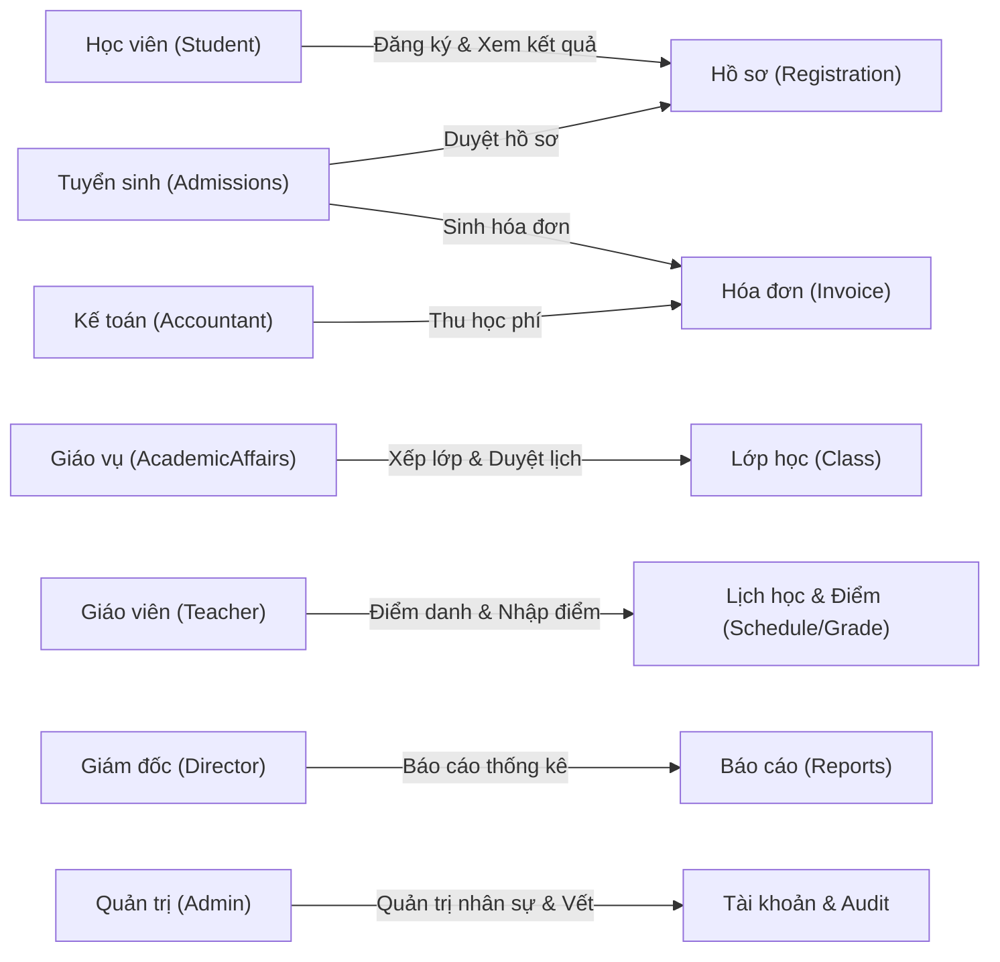

# Yêu cầu dự án DBMS12 EnglishCenter (Project Requirements)

Tài liệu này đặc tả toàn bộ yêu cầu kỹ thuật, yêu cầu chức năng, yêu cầu phi chức năng, tiêu chuẩn bảo mật và điều kiện tiên quyết về môi trường triển khai cho hệ thống **DBMS12 EnglishCenter**.

---

## 1. Tổng quan dự án

- **Tên hệ thống:** DBMS12 EnglishCenter — Hệ thống quản trị trung tâm Anh ngữ.
- **Mục tiêu:** Xây dựng giải pháp quản trị trung tâm đào tạo tiếng Anh khép kín, tập trung vào việc hiện thực hóa các kỹ thuật nâng cao của Hệ quản trị Cơ sở dữ liệu (Microsoft SQL Server): Mô hình chuẩn hóa 3NF, phân quyền người dùng thực tế (Native Security V2), quản lý giao dịch ACID trong T-SQL (Transaction Management D15), kiểm soát tranh chấp đồng thời (Concurrency Control), và cơ chế lưu vết kiểm toán/chống lặp lệnh (Audit Log & Idempotency).
- **Phạm vi mô hình dữ liệu:**
  - **12 Bảng dữ liệu**, **99 Thuộc tính**, đạt chuẩn hóa 3NF.
  - **17 Chỉ mục tường minh (Explicit Indexes)** tối ưu hiệu năng truy vấn.
  - **61 Stored Procedures** (56 thủ tục nghiệp vụ + 5 thủ tục hạ tầng giao tiếp).
  - **7 Functions** (3 hàm bảng TVF + 4 hàm vô hướng).
  - **9 Views** tổng hợp báo cáo và phục vụ truy vấn an toàn.
  - **12 Triggers** kiểm soát toàn vẹn vòng đời và quy chế nghiệp vụ.
  - **3 Table-Valued Parameters (TVP)** và **1 Sequence**.

---

## 2. Yêu cầu chức năng (Functional Requirements - FR)

Hệ thống quản lý chuỗi giá trị đào tạo khép kín với 7 vai trò người dùng độc lập:

| Mã FR | Tên nghiệp vụ | Mô tả chi tiết & Ràng buộc nghiệp vụ | Vai trò thực hiện |
|---|---|---|---|
| **FR01** | Quản lý định danh & Phân quyền | Hỗ trợ 7 vai trò trong hệ thống (ràng buộc `CHECK` trong `Account`). Nhân sự mới nhận mật khẩu tạm ngẫu nhiên và bắt buộc phải đổi mật khẩu ở lần đăng nhập đầu tiên. Học viên được phép tự đăng ký tài khoản. | Admin, Student, Toàn bộ nhân sự |
| **FR02** | Quản lý danh mục Khóa học | Khai báo mã khóa, tên khóa, mức học phí, số buổi dự kiến và trọng số quá trình (%). Khóa học đã mở lớp sẽ bị đóng băng cấu hình tài chính để bảo vệ dữ liệu lịch sử. | AcademicAffairs |
| **FR03** | Đăng ký & Duyệt hồ sơ | Luồng trạng thái hồ sơ: `PENDING` $\rightarrow$ `CONFIRMED` $\rightarrow$ `ADMITTED`. Admissions duyệt hồ sơ đồng thời tự động phát hành hóa đơn nguyên tử trong 1 transaction. Học viên có thể hủy hồ sơ khi đang chờ. | Student, Admissions |
| **FR04** | Thu phí & Quản lý hóa đơn | Mỗi hồ sơ nhập học phát hành đúng 1 hóa đơn thu đủ 1 lần duy nhất (không thu trả góp). Kế toán ghi nhận thu tiền với phương thức thanh toán và số tham chiếu. Cho phép điều chỉnh thông tin chứng từ khi có lý do hợp lệ. | Accountant |
| **FR05** | Quản lý Lớp học & Xếp lớp | Vòng đời lớp học: `PLANNED` $\rightarrow$ `OPEN` $\rightarrow$ `ONGOING` $\rightarrow$ `COMPLETED`. Điều kiện chuyển `OPEN`: có giáo viên và có buổi học tương lai. Điều kiện chuyển `ONGOING`: đủ số buổi học, đúng 1 buổi thi kết thúc, đã có học viên và tới giờ học đầu tiên. Xếp lớp yêu cầu: hồ sơ `ADMITTED`, đã đóng học phí, lớp `OPEN`, còn sĩ số và không trùng lịch. | AcademicAffairs |
| **FR06** | Lập lịch & Điều chỉnh lịch | Tạo lịch học hàng loạt theo lô (TVP) gồm các buổi học (`LESSON`) và đúng 1 buổi thi cuối khóa (`FINAL_EXAM`). Kiểm tra chống trùng lịch giáo viên, phòng học, lớp học và học viên theo khoảng thời gian `[start_at, end_at)`. Hỗ trợ dời lịch các buổi tương lai có lưu vết. | AcademicAffairs |
| **FR07** | Điểm danh & Xác nhận buổi học | Giáo viên phụ trách lớp điểm danh tường minh từng học viên (`PRESENT` / `ABSENT`). Giáo vụ kiểm tra và xác nhận buổi học đã tổ chức (`HELD`) sau giờ kết thúc. | Teacher, AcademicAffairs |
| **FR08** | Nhập điểm, Gửi & Chốt bảng điểm | Giáo viên nhập 2 cột điểm (điểm quá trình và điểm thi cuối khóa) kèm nhận xét. Bảng điểm tuân thủ luồng: `DRAFT` $\rightarrow$ `RETURNED` $\rightarrow$ `SUBMITTED` $\rightarrow$ `FINALIZED`. Điểm cuối khóa chỉ được nhập sau khi buổi thi kết thúc. Giáo vụ duyệt chốt bảng điểm khi lớp `COMPLETED`; bảng điểm `FINALIZED` là bất biến. | Teacher, AcademicAffairs |
| **FR09** | Tra cứu kết quả học tập | Học viên chỉ xem được lớp học, lịch học, hóa đơn và kết quả của chính mình. Điểm tổng kết và trạng thái Đạt/Không đạt do hàm CSDL tính toán theo trọng số và chỉ hiển thị khi bảng điểm đã `FINALIZED`. | Student |
| **FR10** | Báo cáo, Thống kê & Kiểm toán | Giám đốc xem báo cáo tổng hợp tình hình tuyển sinh, đào tạo, doanh thu. Kế toán tra cứu và xuất báo cáo tài chính định dạng CSV (bảo vệ chống công thức độc hại). Admin kiểm tra nhật ký kiểm toán hệ thống (`AuditLog`). | Director, Accountant, Admin |

---

## 3. Yêu cầu phi chức năng (Non-Functional Requirements - NFR)

### 3.1. Tính toàn vẹn và Quản lý giao dịch (ACID & Concurrency)
- **TR01 (SQL-Owned Transactions - D15):** Toàn bộ 61 Stored Procedures tự kiểm soát giao dịch bằng T-SQL (`SET XACT_ABORT ON`, `TRY...CATCH`, `BEGIN/COMMIT/ROLLBACK TRANSACTION`). C# không quản lý transaction thủ công; nếu C# mở giao dịch bao ngoài (`depth = 1`), SP tham gia giao dịch đó và không commit sớm.
- **TR02 (Kiểm soát đồng thời 2 tầng):**
  - *Tầng 1 (Khóa thô):* Tuần tự hóa các tác vụ ghi nhạy cảm bằng `Course WITH(TABLOCKX, HOLDLOCK)`.
  - *Tầng 2 (Khóa lạc quan OCC):* Sử dụng cột phiên bản `row_version` (timestamp) trên các bảng nghiệp vụ chính (`Invoice`, `Registration`, `Class`, `GradeReport`, `Attendance`). Ngăn chặn hoàn toàn hiện tượng Lost Update.
- **TR03 (Chống lặp lệnh - Idempotency):** Áp dụng bảng `ReplayOperation` gắn với khóa `(actor_account_id, action_code, request_id)` và mã băm SHA-256 đầu vào `input_digest`. Trong cửa sổ 24 giờ, thao tác gửi lặp trả về kết quả thành công trước đó từ `AuditLog` mà không ghi dữ liệu lần 2.

### 3.2. Bảo mật hệ thống (Security Architecture - D14)
- **SEC01 (Native SQL Security V2):** 
  - Tạo 7 Database Roles và 7 Database Users dạng `WITHOUT LOGIN`.
  - Toàn bộ 7 role nghiệp vụ bị `DENY` quyền truy cập trực tiếp trên tất cả các bảng. Mọi truy vấn đọc/ghi bắt buộc phải thông qua Stored Procedures và Views được cấp quyền `GRANT EXECUTE` / `GRANT SELECT`.
  - Backend sử dụng ngữ cảnh chuyển quyền an toàn `EXECUTE AS USER = '...'` sau khi đã xác thực token phiên.
- **SEC02 (Bảo vệ định danh & Phiên làm việc):**
  - Mật khẩu mã hóa bằng PBKDF2 HMAC-SHA512 với 220,000 vòng lặp, kết hợp danh sách từ chối mật khẩu yếu (Password Blocklist 12,000 mẫu phổ biến).
  - Phiên làm việc quản lý qua bảng `AuthSession` lưu tại CSDL; Cookie xác thực `__Host-ec12p-auth` (HttpOnly, Secure, SameSite=Strict) và token chống tấn công giả mạo yêu cầu `__Host-ec12p-csrf`.
  - Khóa bảo mật: Sử dụng tài khoản dịch vụ Windows riêng biệt (Non-Administrator), không chia sẻ quyền `sysadmin` hay `db_owner`.

---

## 4. Yêu cầu môi trường & Phần mềm tiên quyết

Để biên dịch và vận hành đầy đủ hệ sinh thái DBMS12 EnglishCenter, máy chủ/máy trạm cần đáp ứng:

| Thành phần | Phiên bản yêu cầu | Mục đích sử dụng |
|---|---|---|
| **Hệ điều hành** | Windows 10/11 x64 | Môi trường lưu trữ chứng chỉ Windows và cơ chế bảo vệ DPAPI |
| **PowerShell** | **PowerShell 7.4+** (`pwsh`) | Chạy các script tự động hóa, kiểm thử và thiết lập hệ thống |
| **.NET SDK** | **.NET SDK 10.0** (bao gồm ASP.NET Core) | Biên dịch và thực thi ứng dụng backend máy chủ |
| **Node.js & npm** | **Node.js $\ge$ 24.x**, **npm $\ge$ 11.x** | Biên dịch giao diện frontend React/TypeScript |
| **Microsoft SQL Server** | **SQL Server 2022** (Express hoặc Developer) | Hệ quản trị CSDL quan hệ chính; cấu hình giao thức Shared Memory (`lpc`) |
| **SQL Server Management Studio** | **SSMS 20+** (tùy chọn) | Truy vấn trực tiếp, chạy 107 bài thực hành và kiểm tra dữ liệu |
| **Trình duyệt Web** | Microsoft Edge hoặc Google Chrome | Giao diện người dùng trên màn hình máy tính và thiết bị di động |

---

## 5. Tiêu chuẩn nghiệm thu (Acceptance Criteria)

1. **Tính toàn vẹn mã nguồn:** Lệnh `node tools/Verify-Source.cjs` trả về `PASS`, 62/62 file SQL canonical khớp 100% mã băm SHA-256 đã công bố trong `manifest.json`.
2. **Biên dịch & Kiểm thử:** Lệnh `pwsh tools/Test-Project.ps1` vượt qua toàn bộ các khâu: NuGet locked restore, backend build 0 cảnh báo 0 lỗi, npm ci, frontend lint, TypeScript check, và 5 bộ unit tests client.
3. **Khởi chạy ứng dụng:** File `Chay-Project.cmd` khởi chạy thành công dịch vụ tại `https://localhost:8446/dbms12`, endpoint `GET /health/ready` phản hồi HTTP 200 `ready`.
4. **Cơ sở dữ liệu:** Lệnh `pwsh tools/Test-Project.ps1 -CheckDatabase` xác nhận kết nối chuẩn xác, cấu trúc đủ 12 bảng, 61 SP, 7 FN, 9 VW, 12 TG và kiểm tra toàn vẹn `DBCC CHECKDB` đạt 0 lỗi.
5. **Khả năng đồng bộ:** Hỗ trợ phục hồi nhanh trạng thái CSDL từ bản sao lưu `.bak` qua công cụ tự động tại `docs/study/dong_bo_database/`, tự khắc phục hoàn toàn lỗi Orphaned User.
