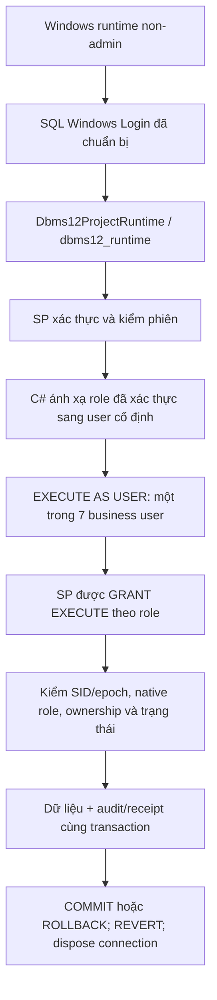

# Phân quyền SQL — DBMS12 Native Security V2

Hướng A được owner giao triển khai ngày 22/10/2026. Giữ 12 bảng/99 cột, 7 function/9 view/12 trigger; 61 SP gồm 56 operation và 5 SP hạ tầng. Không còn thực thi batch dữ liệu trực tiếp trong backend. Các sơ đồ bảng/thuộc tính vẫn đúng vì DDL không đổi.

## Danh tính và đường thực thi

Runtime chỉ có EXECUTE trên các module xác thực/hạ tầng cần thiết và IMPERSONATE trên đúng bảy business user. Không có quyền trực tiếp SELECT/INSERT/UPDATE/DELETE bảng; không có db_owner/sysadmin. Backend vẫn là thành phần tin cậy: nó kiểm mật khẩu, phát SID/JWT và được chuyển vai trò. Phân quyền này không coi việc chiếm được runtime identity là một người dùng nghiệp vụ thông thường.

Máy kiểm dùng Windows Authentication. Bảy business user được tạo WITHOUT LOGIN và thực sự dùng bởi ứng dụng; không phải bảy server login/password riêng. Không bật Mixed Mode, tạo Windows account hay đổi instance dùng chung. Nếu giáo viên yêu cầu mỗi nhân sự đăng nhập trực tiếp SQL, operator phải chuẩn bị Windows identity/login riêng và ánh xạ user vào role phù hợp; đây là bước bổ sung về định danh, không thể mô tả đã hoàn thành chỉ từ impersonation.

## Bảy nhóm nghiệp vụ

| Vai trò ứng dụng | Database role | Database user | Quyền chính |
|---|---|---|---|
| Admin | role_QuanTri | Dbms12Admin | SP quản lý tài khoản/nhân sự và nhật ký an toàn |
| Admissions | role_TuyenSinh | Dbms12Admissions | Danh mục và hồ sơ tuyển sinh, duyệt/từ chối/hủy theo điều kiện |
| AcademicAffairs | role_GiaoVu | Dbms12AcademicAffairs | Khóa/lớp/lịch, xếp lớp, hoàn thành lớp và duyệt bảng điểm |
| Teacher | role_GiaoVien | Dbms12Teacher | Lớp phụ trách, roster/điểm danh/điểm và gửi bảng điểm |
| Accountant | role_KeToan | Dbms12Accountant | Hóa đơn, thu đủ, điều chỉnh metadata và báo cáo/CSV tài chính |
| Director | role_GiamDoc | Dbms12Director | SP/view báo cáo tổng hợp; không ghi nghiệp vụ |
| Student | role_HocVien | Dbms12Student | Hồ sơ, đăng ký, hóa đơn, lớp/lịch/kết quả của chính mình |

Ma trận từng SP nằm tại [SQL_SECURITY_MATRIX.md](SQL_SECURITY_MATRIX.md), sinh từ manifest; `08_permissions.sql` là nguồn GRANT/DENY thật. Bốn nhóm kỹ thuật cũ được giữ để tương thích định danh nhưng quyền trực tiếp bảng được thu hồi. Operator chỉ dùng SP bootstrap/maintenance, reader chỉ dùng view tổng hợp/an toàn. Không cấp view chứa toàn bộ học viên cho Student/Teacher. Những view này chỉ được dùng bên trong SP có lọc ownership.

## Giao dịch và bảo vệ dữ liệu

C# mở transaction và gọi SP lấy khóa Course, sau đó xác thực phiên và chuyển sang user nghiệp vụ cố định. SP chạy với CALLER và ownership chaining cùng chủ sở hữu dbo; không dùng EXECUTE AS OWNER hay SQL động nghiệp vụ. Mỗi SP xác định Actor từ SID/epoch và kiểm role SQL khớp role Account; caller không truyền Actor để chọn người khác. ProfileUpdate được giới hạn Student cả HTTP lẫn SQL.

SP command tự kiểm UUID/digest/replay, thực hiện nghiệp vụ, kiểm phiên cuối, ghi AuditLog/ReplayOperation và activity trước khi trả ACK. C# COMMIT với token độc lập request, ROLLBACK khi chưa commit và REVERT trong cleanup. Kết nối không pooling. Hủy yêu cầu/mất ACK không tự gửi lại; lookup vẫn chỉ của actor hiện tại. Không nhận tên user/role/SP/SQL tự do từ browser.

Admin nghiệp vụ không được thu tiền, xếp lớp hoặc sửa điểm. Kế toán không quản lý tài khoản hay bảng điểm. Director chỉ đọc báo cáo; không được cấp SELECT/EXECUTE toàn schema. Hạn chế không áp dụng như một rào chắn đối với chủ máy SQL sysadmin; owner triển khai là danh tính khác với Admin ứng dụng.

## Kiểm và migration

- `tools/Test-Project.ps1`: nguồn, build, types/lint/5 client tests/build.
- `tools/Invoke-SecurityRehearsal.ps1`: tạo fixture PROJECT độc lập, không reset dữ liệu hiện hành; native SQL rồi HTTP/UI. Chỉ dùng driver Edge/Playwright đã chuẩn bị, TLS tin cậy.
- CLI `--verify-security <fixture-profile>` chỉ nhận workspace fixture riêng; kiểm native permissions/ownership, GRANT–REVOKE–DENY và context cleanup. Không dùng để ghi test vào database owner.
- CLI `--rehearse-security-migration <profile>`: yêu cầu legacy manifest chính xác, database name/ID/GUID/file GUID và 11 định nghĩa SP legacy khớp; thử thay module/quyền trong transaction, so hash tất cả hàng rồi ROLLBACK; không thay profile.
- CLI `--migrate-security <profile>`: cùng guard và kiểm dữ liệu, COMMIT rồi cập nhật profile theo phiên bản mới. Host phải dừng bình thường. Chỉ module/permissions; không chạy schema/sample/seed. Receipt và rollback SQL nằm trong `.local/operator/security-migrations/`, không đưa vào ZIP/Git.

REVOKE gỡ một quyền đã cấp/cấm; quyền kế thừa có thể còn. Test minh họa dùng một user kiểm không có quyền kế thừa, rồi rollback toàn bộ. Việc chặn DML thực tế dùng DENY trên 12 bảng kết hợp bỏ các column GRANT cũ. Không dùng REVOKE DELETE để diễn đạt một lệnh cấm tuyệt đối.

Tham chiếu ngữ nghĩa: [Microsoft về ownership chaining](https://learn.microsoft.com/en-us/sql/relational-databases/tutorial-ownership-chains-and-context-switching?view=sql-server-ver15), [EXECUTE AS và REVERT](https://learn.microsoft.com/en-us/sql/t-sql/statements/execute-as-transact-sql?view=sql-server-ver17), [REVOKE](https://learn.microsoft.com/en-us/sql/t-sql/statements/revoke-transact-sql?view=sql-server-ver17).

## Ranh giới bằng chứng

Kết quả mới và source hashes tại `docs/evidence/sql-security/`; các PASS trước ngày đổi chỉ thuộc bản 11 SP cũ. Kiểm trên máy này không chứng minh cài máy khác, public deployment, backup/restore, tải lớn hoặc đáp ứng toàn bộ rubric chưa được cung cấp.
