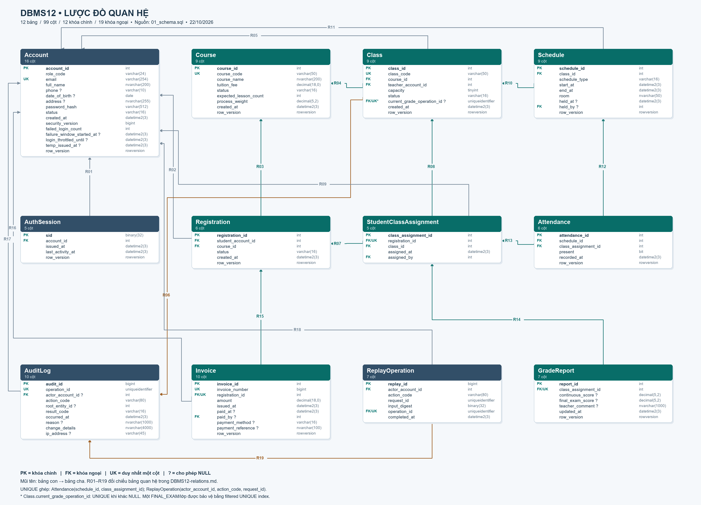

# Lược đồ quan hệ DBMS12

Sinh từ `../../database/dbms12-compact/01_schema.sql`, ngày 22/10/2026. Đúng 12 bảng, 99 cột, 12 PK và 19 FK. Chỉ mô tả schema hiện tại; không thay đổi database.



Ảnh PNG và PDF chứa đủ 99 cột. SVG phóng to không vỡ nét; file `.drawio` mở bằng diagrams.net để chỉnh vị trí; `.mmd` chứa ERD Mermaid đầy đủ. Mũi tên trong ảnh/drawio đi từ FK ở bảng con tới khóa được tham chiếu ở bảng cha. Mermaid dùng ký pháp chân quạ.

PK: khóa chính; FK: khóa ngoại; UK: UNIQUE một cột; `?`: NULL. UK* của Class là filtered UNIQUE khi khác NULL. Trong Mermaid, dấu phẩy trong kiểu decimal được đổi thành `_` để parser đọc được, ví dụ `decimal(5_2)` nghĩa là SQL `decimal(5,2)`.

## 19 quan hệ vật lý

|Mã|Khóa ngoại (con)|Khóa đích (cha)|Số cha / mỗi con|Số con / mỗi cha|
|---|---|---|---|---|
|R01|`AuthSession.account_id`|`Account.account_id`|1|0..N|
|R02|`Registration.student_account_id`|`Account.account_id`|1|0..N|
|R03|`Registration.course_id`|`Course.course_id`|1|0..N|
|R04|`Class.course_id`|`Course.course_id`|1|0..N|
|R05|`Class.teacher_account_id`|`Account.account_id`|1|0..N|
|R06|`Class.current_grade_operation_id`|`AuditLog.operation_id`|0..1|0..1|
|R07|`StudentClassAssignment.registration_id`|`Registration.registration_id`|1|0..1|
|R08|`StudentClassAssignment.class_id`|`Class.class_id`|1|0..N|
|R09|`StudentClassAssignment.assigned_by`|`Account.account_id`|1|0..N|
|R10|`Schedule.class_id`|`Class.class_id`|1|0..N|
|R11|`Schedule.held_by`|`Account.account_id`|0..1|0..N|
|R12|`Attendance.schedule_id`|`Schedule.schedule_id`|1|0..N|
|R13|`Attendance.class_assignment_id`|`StudentClassAssignment.class_assignment_id`|1|0..N|
|R14|`GradeReport.class_assignment_id`|`StudentClassAssignment.class_assignment_id`|1|0..1|
|R15|`Invoice.registration_id`|`Registration.registration_id`|1|0..1|
|R16|`Invoice.paid_by`|`Account.account_id`|0..1|0..N|
|R17|`AuditLog.actor_account_id`|`Account.account_id`|0..1|0..N|
|R18|`ReplayOperation.actor_account_id`|`Account.account_id`|1|0..N|
|R19|`ReplayOperation.operation_id`|`AuditLog.operation_id`|1|0..1|

## Ràng buộc cần giải thích trong báo cáo

- Account dùng chung cho 7 vai trò. `student_account_id` và `teacher_account_id` cùng tham chiếu Account; trigger/SQL kiểm đúng vai trò, FK đơn thuần không phân biệt vai trò.
- Registration là thực thể nối học viên với Course, có trạng thái riêng; không có UNIQUE toàn cặp student/course. Nghiệp vụ ngăn trùng hồ sơ chưa kết thúc.
- Registration → Invoice và Registration → StudentClassAssignment: 1 → 0..1 do FK NOT NULL + UNIQUE. Invoice chỉ có khi duyệt; assignment chỉ có khi đủ điều kiện xếp lớp.
- StudentClassAssignment → GradeReport: DDL là 1 → 0..1. `usp_PlacementCreate` tạo report stub cùng transaction với assignment trong luồng ứng dụng; không đổi ký hiệu vật lý thành bắt buộc 1–1.
- Attendance có UNIQUE(schedule_id, class_assignment_id). Trigger bảo vệ buổi và assignment thuộc cùng lớp; không có FK trực tiếp Attendance → Class.
- ReplayOperation có UNIQUE(actor_account_id, action_code, request_id) và UNIQUE(operation_id). AuditLog → ReplayOperation là 1 → 0..1.
- Class.current_grade_operation_id tham chiếu **AuditLog.operation_id (UK)**, không phải audit_id (PK). Filtered UNIQUE khiến một operation được tối đa một Class tham chiếu.
- AuditLog.root_entity_id là tham chiếu đa loại theo action, được guard SQL/trigger; không phải FK vật lý nên không vẽ thêm đường FK.
- Schedule có filtered UNIQUE(class_id) chỉ khi schedule_type = FINAL_EXAM; mỗi lớp tối đa một lịch thi cuối khóa, vẫn có nhiều LESSON.
- Tất cả 19 FK có ON DELETE NO ACTION và ON UPDATE NO ACTION. Không có cascade.
- Tổng điểm/đạt, trạng thái thanh toán/công nợ, trạng thái bảng điểm được suy ra; không thêm cột total_score/passed hoặc bảng Role/Payment/Band/Program.

## Biểu diễn quan hệ đủ thuộc tính

Dấu **đậm** là PK, `→` là FK; kiểu/nullability xem ảnh hoặc Mermaid.

- **Account** (**`account_id`**, `role_code`, `email`, `full_name`, `phone`, `date_of_birth`, `address`, `password_hash`, `status`, `created_at`, `security_version`, `failed_login_count`, `failure_window_started_at`, `login_throttled_until`, `temp_issued_at`, `row_version`).
- **AuthSession** (**`sid`**, `account_id` → Account.account_id, `issued_at`, `last_activity_at`, `row_version`).
- **Course** (**`course_id`**, `course_code`, `course_name`, `tuition_fee`, `status`, `expected_lesson_count`, `process_weight`, `created_at`, `row_version`).
- **Registration** (**`registration_id`**, `student_account_id` → Account.account_id, `course_id` → Course.course_id, `status`, `created_at`, `row_version`).
- **Class** (**`class_id`**, `class_code`, `course_id` → Course.course_id, `teacher_account_id` → Account.account_id, `capacity`, `status`, `current_grade_operation_id` → AuditLog.operation_id, `created_at`, `row_version`).
- **StudentClassAssignment** (**`class_assignment_id`**, `registration_id` → Registration.registration_id, `class_id` → Class.class_id, `assigned_at`, `assigned_by` → Account.account_id).
- **Schedule** (**`schedule_id`**, `class_id` → Class.class_id, `schedule_type`, `start_at`, `end_at`, `room`, `held_at`, `held_by` → Account.account_id, `row_version`).
- **Attendance** (**`attendance_id`**, `schedule_id` → Schedule.schedule_id, `class_assignment_id` → StudentClassAssignment.class_assignment_id, `present`, `recorded_at`, `row_version`).
- **GradeReport** (**`report_id`**, `class_assignment_id` → StudentClassAssignment.class_assignment_id, `continuous_score`, `final_exam_score`, `teacher_comment`, `updated_at`, `row_version`).
- **Invoice** (**`invoice_id`**, `invoice_number`, `registration_id` → Registration.registration_id, `amount`, `issued_at`, `paid_at`, `paid_by` → Account.account_id, `payment_method`, `payment_reference`, `row_version`).
- **AuditLog** (**`audit_id`**, `operation_id`, `actor_account_id` → Account.account_id, `action_code`, `root_entity_id`, `result_code`, `occurred_at`, `reason`, `change_details`, `ip_address`).
- **ReplayOperation** (**`replay_id`**, `actor_account_id` → Account.account_id, `action_code`, `request_id`, `input_digest`, `operation_id` → AuditLog.operation_id, `completed_at`).

## ERD Mermaid

```mermaid
erDiagram
    direction LR
    Account {
        int account_id PK "NOT NULL"
        varchar(24) role_code  "NOT NULL"
        varchar(254) email UK "NOT NULL"
        nvarchar(200) full_name  "NOT NULL"
        varchar(10) phone  "NULL"
        date date_of_birth  "NULL"
        nvarchar(255) address  "NULL"
        varchar(512) password_hash  "NOT NULL"
        varchar(16) status  "NOT NULL"
        datetime2(3) created_at  "NOT NULL"
        bigint security_version  "NOT NULL"
        int failed_login_count  "NOT NULL"
        datetime2(3) failure_window_started_at  "NULL"
        datetime2(3) login_throttled_until  "NULL"
        datetime2(3) temp_issued_at  "NULL"
        rowversion row_version  "NOT NULL"
    }
    AuthSession {
        binary(32) sid PK "NOT NULL"
        int account_id FK "NOT NULL"
        datetime2(3) issued_at  "NOT NULL"
        datetime2(3) last_activity_at  "NOT NULL"
        rowversion row_version  "NOT NULL"
    }
    Course {
        int course_id PK "NOT NULL"
        varchar(50) course_code UK "NOT NULL"
        nvarchar(200) course_name  "NOT NULL"
        decimal(18_0) tuition_fee  "NOT NULL"
        varchar(16) status  "NOT NULL"
        int expected_lesson_count  "NOT NULL"
        decimal(5_2) process_weight  "NOT NULL"
        datetime2(3) created_at  "NOT NULL"
        rowversion row_version  "NOT NULL"
    }
    Registration {
        int registration_id PK "NOT NULL"
        int student_account_id FK "NOT NULL"
        int course_id FK "NOT NULL"
        varchar(16) status  "NOT NULL"
        datetime2(3) created_at  "NOT NULL"
        rowversion row_version  "NOT NULL"
    }
    Class {
        int class_id PK "NOT NULL"
        varchar(50) class_code UK "NOT NULL"
        int course_id FK "NOT NULL"
        int teacher_account_id FK "NOT NULL"
        tinyint capacity  "NOT NULL"
        varchar(16) status  "NOT NULL"
        uniqueidentifier current_grade_operation_id FK,UK "NULL; filtered UNIQUE when non-NULL"
        datetime2(3) created_at  "NOT NULL"
        rowversion row_version  "NOT NULL"
    }
    StudentClassAssignment {
        int class_assignment_id PK "NOT NULL"
        int registration_id FK,UK "NOT NULL"
        int class_id FK "NOT NULL"
        datetime2(3) assigned_at  "NOT NULL"
        int assigned_by FK "NOT NULL"
    }
    Schedule {
        int schedule_id PK "NOT NULL"
        int class_id FK "NOT NULL"
        varchar(16) schedule_type  "NOT NULL"
        datetime2(3) start_at  "NOT NULL"
        datetime2(3) end_at  "NOT NULL"
        nvarchar(50) room  "NOT NULL"
        datetime2(3) held_at  "NULL"
        int held_by FK "NULL"
        rowversion row_version  "NOT NULL"
    }
    Attendance {
        int attendance_id PK "NOT NULL"
        int schedule_id FK "NOT NULL"
        int class_assignment_id FK "NOT NULL"
        bit present  "NOT NULL"
        datetime2(3) recorded_at  "NOT NULL"
        rowversion row_version  "NOT NULL"
    }
    GradeReport {
        int report_id PK "NOT NULL"
        int class_assignment_id FK,UK "NOT NULL"
        decimal(5_2) continuous_score  "NULL"
        decimal(5_2) final_exam_score  "NULL"
        nvarchar(1000) teacher_comment  "NULL"
        datetime2(3) updated_at  "NOT NULL"
        rowversion row_version  "NOT NULL"
    }
    Invoice {
        int invoice_id PK "NOT NULL"
        bigint invoice_number UK "NOT NULL"
        int registration_id FK,UK "NOT NULL"
        decimal(18_0) amount  "NOT NULL"
        datetime2(3) issued_at  "NOT NULL"
        datetime2(3) paid_at  "NULL"
        int paid_by FK "NULL"
        varchar(16) payment_method  "NULL"
        nvarchar(100) payment_reference  "NULL"
        rowversion row_version  "NOT NULL"
    }
    AuditLog {
        bigint audit_id PK "NOT NULL"
        uniqueidentifier operation_id UK "NOT NULL"
        int actor_account_id FK "NULL"
        varchar(80) action_code  "NOT NULL"
        int root_entity_id  "NULL"
        varchar(16) result_code  "NOT NULL"
        datetime2(3) occurred_at  "NOT NULL"
        nvarchar(1000) reason  "NULL"
        nvarchar(4000) change_details  "NOT NULL"
        varchar(45) ip_address  "NULL"
    }
    ReplayOperation {
        bigint replay_id PK "NOT NULL"
        int actor_account_id FK "NOT NULL"
        varchar(80) action_code  "NOT NULL"
        uniqueidentifier request_id  "NOT NULL"
        binary(32) input_digest  "NOT NULL"
        uniqueidentifier operation_id FK,UK "NOT NULL"
        datetime2(3) completed_at  "NOT NULL"
    }
    Account ||..o{ AuthSession : "R01 account_id"
    Account ||..o{ Registration : "R02 student_account_id"
    Course ||..o{ Registration : "R03 course_id"
    Course ||..o{ Class : "R04 course_id"
    Account ||..o{ Class : "R05 teacher_account_id"
    AuditLog |o..o| Class : "R06 current_grade_operation_id"
    Registration ||..o| StudentClassAssignment : "R07 registration_id"
    Class ||..o{ StudentClassAssignment : "R08 class_id"
    Account ||..o{ StudentClassAssignment : "R09 assigned_by"
    Class ||..o{ Schedule : "R10 class_id"
    Account |o..o{ Schedule : "R11 held_by"
    Schedule ||..o{ Attendance : "R12 schedule_id"
    StudentClassAssignment ||..o{ Attendance : "R13 class_assignment_id"
    StudentClassAssignment ||..o| GradeReport : "R14 class_assignment_id"
    Registration ||..o| Invoice : "R15 registration_id"
    Account |o..o{ Invoice : "R16 paid_by"
    Account |o..o{ AuditLog : "R17 actor_account_id"
    Account ||..o{ ReplayOperation : "R18 actor_account_id"
    AuditLog ||..o| ReplayOperation : "R19 operation_id"
```
