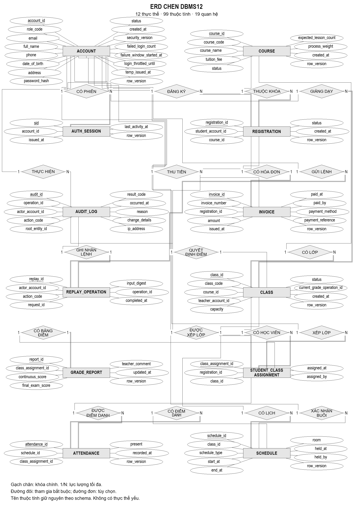

# ERD Chen cho một trang A4 dọc

Dàn lại thành2cột×6hàng; giữ đủ12thực thể,99thuộc tính,19quan hệ và phong cách giáo trình. Không thu nhỏ ảnh ngang cũ.

[SVG vector](ERD-Chen-A4-portrait.svg) · [PNG](ERD-Chen-A4-portrait.png) · [PDF một trang A4](ERD-Chen-A4-portrait.pdf) · [drawio](ERD-Chen-A4-portrait.drawio)

## Chèn vào Word

1. Layout → Size → A4; Orientation → Portrait.
2. Margins → Custom Margins: đặt cả bốn lề1,5cm.
3. Insert → Pictures → chọnSVG (ưu tiên) hoặcPNG. Đặt In Line with Text, khóa tỷ lệ, Width=18cm; Height≈26cm.
4. Đặt đoạn chứa ảnh Before=0, After=0, line spacing Single. Không chèn thêm caption dài trên cùng trang; ảnh đã có tiêu đề.

SVG có kích thước vật lý18×26cm;PDF210×297mm đúng một trang. PNG1800×2600px,254dpi. Chữ thuộc tính23đơn vị tương đương6,52pt khi in rộng18cm, lớn hơn đáng kể bản ngang cũ (~1,36pt cùng chiều rộng). Vì giữ đủ99thuộc tính và19quan hệ, chữ vẫn nhỏ; phải xem/in đúng100% để đánh giá. Không claim dễ đọc như nội dung thân bài11–12pt.

Đường nối được dàn lại tránh các hộp chứa chữ; vẫn có giao cắt giữa đường trong mô hình nhiều quan hệ. KiểuSQL/NULL/UNIQUE chi tiết xemERD-full-attributes.md. Không bỏ thuộc tính hoặc thay model để ép trang.
