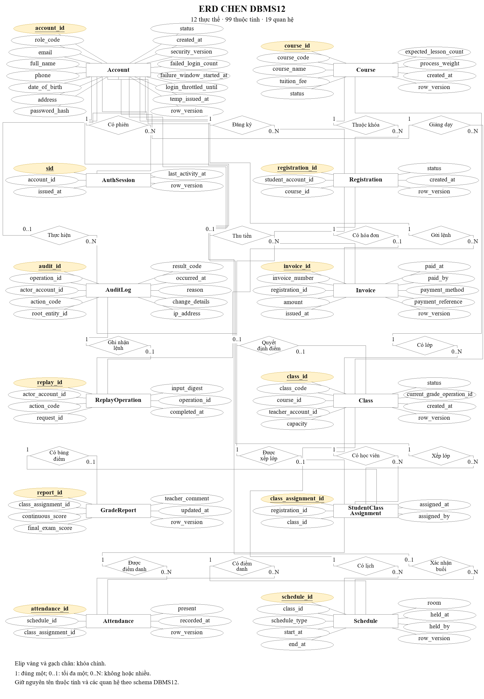

# ERD Chen A4 theo mẫu báo cáo

Sơ đồ sử dụng phong cách ảnh mẫu: thực thể và quan hệ có nền trắng, viền xám mảnh, font Times New Roman; tên thực thể in đậm; khóa chính nằm trong elip vàng nhạt và được gạch chân. Tên bảng và thuộc tính giữ nguyên theo SQL của dự án.

[SVG](ERD-Chen-A4-sample.svg) · [PNG](ERD-Chen-A4-sample.png) · [PDF một trang A4](ERD-Chen-A4-sample.pdf) · [drawio](ERD-Chen-A4-sample.drawio)

## Nội dung và lực lượng

Sơ đồ có đủ 12 thực thể, 99 thuộc tính và 19 quan hệ. Các đường nối dùng nét đơn với nhãn min..max như ảnh mẫu. Nhãn phía cha cho biết số cha của mỗi con: 1 hoặc 0..1 theo khả năng NULL của FK. Nhãn phía con cho biết số con của mỗi cha: 0..1 nếu FK là UNIQUE, 0..N nếu không. Nhãn đặt cạnh hình thoi, lệch trên/dưới để tránh chồng chữ trong trang A4.

DDL không buộc mỗi bản ghi cha phải có ít nhất một bản ghi con. Course có thể chưa có lớp; Registration chưa duyệt chưa có Invoice; Class chưa xếp lớp chưa có assignment. Vì vậy các quan hệ này dùng 0..N hoặc 0..1. Quy trình ứng dụng còn có điều kiện theo trạng thái.

Class.current_grade_operation_id tham chiếu AuditLog.operation_id (UK). AuditLog.root_entity_id là tham chiếu theo action, không phải FK vật lý. StudentClassAssignment có tối đa một GradeReport theo DDL; ứng dụng tạo report stub cùng giao dịch xếp lớp.

## Chèn Word A4 dọc

Chọn A4 Portrait, đặt cả bốn lề 1,5 cm. Chèn SVG (ưu tiên) hoặc PNG, chọn In Line with Text, giữ tỷ lệ và đặt rộng 18 cm, cao 26 cm. Đặt khoảng cách đoạn Before/After bằng 0. Ảnh đã có tiêu đề; tránh thêm chú thích dài làm tràn trang.

SVG có kích thước 18 × 26 cm; PNG 1800 × 2600 px, 254 dpi; PDF đúng một trang 210 × 297 mm. Chữ thuộc tính Times New Roman tương đương 6,24–6,52 pt khi ảnh rộng 18 cm, vẫn nhỏ vì giữ đủ 99 thuộc tính. Thay đổi này chỉ thuộc cách trình bày, không thay đổi schema, dữ liệu hoặc runtime.
