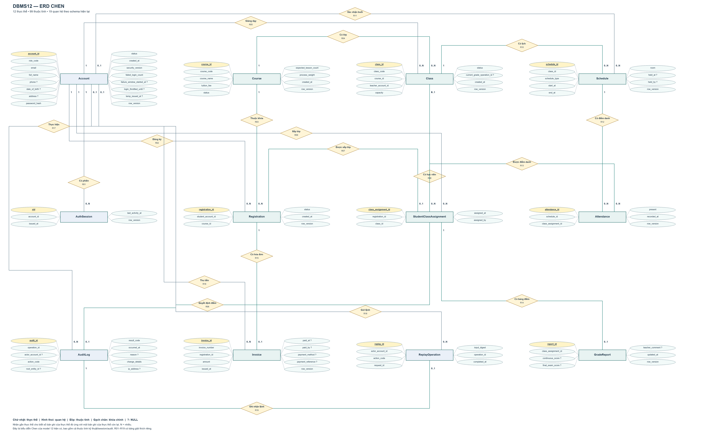

# ERD Chen — DBMS12

Owner chọn ký pháp Chen: thực thể hình chữ nhật, quan hệ hình thoi, thuộc tính hình elip. Sơ đồ bám model12 hiện có và giữ đủ99thuộc tính (kể cả cột kỹ thuật),12thực thể/19quan hệ. Không thêm thực thể Student/Teacher riêng: đó là vai trò Account.

[SVG phóng to](ERD-Chen.svg) · [PDF tổng thể và12trang phóng to](ERD-Chen.pdf) · [diagrams.net chỉnh sửa](ERD-Chen.drawio)

## Ký hiệu

- Khóa chính được gạch chân. Dấu `?` là NULL. Elip không đánh dấu khóa ngoại vì quan hệ đã được biểu diễn bằng hình thoi; tên cột FK vẫn giữ để đủ99thuộc tính vật lý.
- Nhãn gần thực thể chỉ số bản ghi của thực thể đó ứng với một bản ghi của thực thể còn lại: `1`, `0..1`, `0..N`.
- Không dùng elip kép/thuộc tính đa trị hoặc hình chữ nhật kép/thực thể yếu vì schema không khai báo các loại đó. Không thêm thuộc tính tổng điểm/đạt suy ra thành cột.
- Đây là biểu diễn Chen của model thực tế, có cả session/audit/replay; không tự tái thiết kế nghiệp vụ. Kiểu SQL/UK/nullability đầy đủ nằm trong ERD-full-attributes.md.

## Quan hệ và nguồn khóa ngoại

|Mã|Thực thể cha|Quan hệ|Thực thể con|Nguồn FK|Số cha/con|Số con/cha|
|---|---|---|---|---|---|---|
|R01|Account|Có phiên|AuthSession|account_id → account_id|1|0..N|
|R02|Account|Đăng ký|Registration|student_account_id → account_id|1|0..N|
|R03|Course|Thuộc khóa|Registration|course_id → course_id|1|0..N|
|R04|Course|Có lớp|Class|course_id → course_id|1|0..N|
|R05|Account|Giảng dạy|Class|teacher_account_id → account_id|1|0..N|
|R06|AuditLog|Quyết định điểm|Class|current_grade_operation_id → operation_id|0..1|0..1|
|R07|Registration|Được xếp lớp|StudentClassAssignment|registration_id → registration_id|1|0..1|
|R08|Class|Có học viên|StudentClassAssignment|class_id → class_id|1|0..N|
|R09|Account|Xếp lớp|StudentClassAssignment|assigned_by → account_id|1|0..N|
|R10|Class|Có lịch|Schedule|class_id → class_id|1|0..N|
|R11|Account|Xác nhận buổi|Schedule|held_by → account_id|0..1|0..N|
|R12|Schedule|Có điểm danh|Attendance|schedule_id → schedule_id|1|0..N|
|R13|StudentClassAssignment|Được điểm danh|Attendance|class_assignment_id → class_assignment_id|1|0..N|
|R14|StudentClassAssignment|Có bảng điểm|GradeReport|class_assignment_id → class_assignment_id|1|0..1|
|R15|Registration|Có hóa đơn|Invoice|registration_id → registration_id|1|0..1|
|R16|Account|Thu tiền|Invoice|paid_by → account_id|0..1|0..N|
|R17|Account|Thực hiện|AuditLog|actor_account_id → account_id|0..1|0..N|
|R18|Account|Gửi lệnh|ReplayOperation|actor_account_id → account_id|1|0..N|
|R19|AuditLog|Ghi nhận lệnh|ReplayOperation|operation_id → operation_id|1|0..1|

Class.current_grade_operation_id tham chiếu AuditLog.operation_id (UNIQUE), không phải audit_id. UNIQUE lọc đảm bảo một operation được tối đa một Class tham chiếu. GradeReport là0..1 theoDDL; ứng dụng tạo stub cùng transaction xếp lớp. AuditLog.root_entity_id là tham chiếu theo action, không phảiFK vật lý nên không thêm hình thoi.

Nguồn: ../../database/dbms12-compact/01_schema.sql. Chỉ sinh tài liệu; không thay schema/database/runtime.
