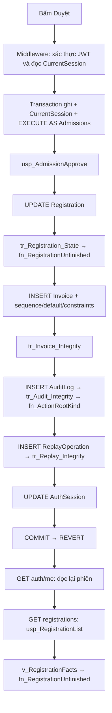

# Ví dụ cụ thể: duyệt hồ sơ và mọi đường gọi T-SQL liên quan

Ngày đối chiếu: 22/10/2026. Nguồn: bản DBMS12 hiện tại (61SP,7FN,9VW,12trigger). Đây là lần theo mã nguồn, không chạy giao dịch thử và không phải bản trace SQL thực tế/Execution Plan. Không suy ra số lần function chạy cho từng hàng hoặc mọi bảng vật lý SQL optimizer đọc từ sơ đồ này.

## 1. Tình huống minh họa

Các ID/số tiền sau là giả định để giải thích, không khẳng định là dữ liệu đang có:

|Đối tượng|Trước thao tác|Sau thành công|
|---|---|---|
|Nhân viên|account_id=10,role_code=Admissions,phiên NORMAL hợp lệ|Vẫn vai trò cũ|
|Course|course_id=7,tuition_fee=2000000|Không sửa|
|Registration|registration_id=100,course_id=7,status=CONFIRMED,row_version=V1|ADMITTED,row_version mới do SQL Server sinh|
|Invoice|Chưa có hóa đơn cho hồ sơ100|Một hóa đơn amount=2000000,paid_at=NULL|
|AuditLog|Chưa có operation mới|Một SUCCESS cho DBMS12.ADMISSIONS.REGISTRATION.APPROVE,root_entity_id=100|
|ReplayOperation|Chưa có UUID yêu cầu|Một completion khớp actor/action/request/digest/operation|
|AuthSession|Thời điểm hoạt động trước đó|last_activity_at được cập nhật|

UI: Tuyển sinh → Hồ sơ nhập học → chọn hồ sơ Đã xác nhận → Duyệt và phát hành hóa đơn. Frontend gửi POST /api/dbms12/admissions/approve với registrationId/expectedVersion, Idempotency-Key và CSRF. SID/epoch/digest/actor không lấy tùy ý từ nội dung browser; SID/epoch từ phiên và digest từ backend. Giao diện chỉ hiển thị nút duyệt khi CONFIRMED.

## 2. Bản đồ từ click tới dữ liệu mới trên UI



Đây là nhánh yêu cầu mới thành công, CSRF đã có, không logout/login lại, không tác vụ bảo trì hoặc health polling chen vào. Nếu chưa có CSRF, frontend gọi thêm GET auth/csrf trước POST; route này cũng qua bước đọc phiên. Nhánh replay/lỗi trình bày riêng bên dưới.

## 3. T-SQL hạ tầng thật trước nghiệp vụ

Mỗi RunAsync mở connection riêng (không pooling), kiểm profile rồi chạy executor. Batch kiểm profile dưới đây đọc metadata, không sửa dữ liệu nghiệp vụ:

```sql
SELECT DB_NAME(),DB_ID(),(SELECT file_guid FROM sys.database_files WHERE file_id=1),
(SELECT COUNT(*) FROM sys.tables WHERE is_ms_shipped=0),
(SELECT COUNT(*) FROM sys.procedures WHERE is_ms_shipped=0),
USER_NAME(),IS_SRVROLEMEMBER('sysadmin'),IS_ROLEMEMBER('dbms12_runtime');
```

C# đối chiếu đúng catalog/DBID/fileGUID/12tables/61procedures/Dbms12ProjectRuntime/khôngsysadmin/runtime role. Không phải schema migration hay CREATE LOGIN ở mỗi click.

Mỗi executor kiểm connection không có transaction cũ:

```sql
SELECT @@TRANCOUNT AS depth;
```

Middleware kiểm phiên bằng một transaction đọc riêng:

```sql
SET XACT_ABORT ON;
BEGIN TRANSACTION;
EXEC dbo.usp_BeginRead;
EXEC dbo.usp_CurrentSession @Sid,@Epoch;
COMMIT;
```

CurrentSession gọi SecuritySession và đọc Account/AuthSession. Đây chỉ xác thực, chưa đổi Registration/Invoice. Kiểm JWT và CSRF ở C#, không phải function T-SQL.

Sau đó transaction nghiệp vụ mới bắt đầu trên connection khác:

```sql
SET XACT_ABORT ON;
BEGIN TRANSACTION;
EXEC dbo.usp_BeginWrite;
EXEC dbo.usp_CurrentSession @Sid,@Epoch;
EXECUTE AS USER='Dbms12Admissions';
-- SqlCommand thực tế dùng CommandType.StoredProcedure + typed parameters:
EXEC dbo.usp_AdmissionApprove
    @Sid=@Sid,@Epoch=@Epoch,@RequestId=@RequestId,@Digest=@Digest,
    @RegistrationId=100,@ExpectedVersion=@ExpectedVersion;
-- Chỉ khi stored procedure hoàn tất không lỗi:
COMMIT;
REVERT;
SELECT USER_NAME() AS principal_name;
```

Batch trên diễn tả thứ tự các SqlCommand; ứng dụng không ghép thành một script có literal SID/password. ExpectedVersion là 8byte rowversion đọc từ hồ sơ; không phải thời gian. BeginWrite và phần đầu SP giữ khóa Course để phối hợp các nghiệp vụ. CurrentSession bên trong transaction ghi vẫn chưa impersonate; SecuritySession ở SP nghiệp vụ mới kiểm native role.

Các quyền đã cài liên quan (không chạy GRANT/CREATE USER lại khi click): role_TuyenSinh có EXECUTE usp_AdmissionApprove; Dbms12Admissions là user WITHOUT LOGIN thuộc role đó; runtime có IMPERSONATE user cố định. Các role bị DENY thao tác trực tiếp bảng, module dbo ownership chain thực thi DML bên trong, không dùng EXECUTE AS OWNER.

## 4. Định nghĩa đầy đủ các SP hạ tầng được gọi


### usp_BeginRead

Nguồn: [usp_BeginRead](../../database/dbms12-compact/infrastructure/begin-read.sql), dòng 1.

```sql
CREATE OR ALTER PROCEDURE dbo.usp_BeginRead
AS
BEGIN
SET NOCOUNT ON; SET XACT_ABORT ON; IF @@TRANCOUNT<>1 THROW 51200,N'Caller phải mở transaction.',1; DECLARE @Rows bigint; SELECT @Rows=COUNT_BIG(*) FROM dbo.Course WITH(TABLOCK,HOLDLOCK);
END;
```

### usp_BeginWrite

Nguồn: [usp_BeginWrite](../../database/dbms12-compact/infrastructure/begin-write.sql), dòng 1.

```sql
CREATE OR ALTER PROCEDURE dbo.usp_BeginWrite
AS
BEGIN
SET NOCOUNT ON; SET XACT_ABORT ON; IF @@TRANCOUNT<>1 THROW 51200,N'Caller phải mở transaction.',1; DECLARE @Rows bigint; SELECT @Rows=COUNT_BIG(*) FROM dbo.Course WITH(TABLOCKX,HOLDLOCK);
END;
```

### usp_CurrentSession

Nguồn: [usp_CurrentSession](../../database/dbms12-compact/queries/usp_CurrentSession.sql), dòng 1.

```sql
CREATE OR ALTER PROCEDURE dbo.usp_CurrentSession
 @Sid binary(32),
 @Epoch bigint
AS
BEGIN
 SET NOCOUNT ON; SET XACT_ABORT ON;
 IF @@TRANCOUNT<>1 THROW 51200,N'Caller phải mở transaction.',1;
 DECLARE @SecurityLockRows bigint;
 SELECT @SecurityLockRows=COUNT_BIG(*) FROM dbo.Course WITH(TABLOCK,HOLDLOCK);
 DECLARE @Actor int,@SessionRole varchar(24);
 EXEC dbo.usp_SecuritySession @Sid,@Epoch,NULL,1,0,@Actor OUTPUT,@SessionRole OUTPUT;
SELECT a.account_id,a.role_code,a.email,a.full_name,a.phone,a.date_of_birth,a.address,a.row_version,
            CASE WHEN a.temp_issued_at IS NULL THEN 'NORMAL' ELSE 'PASSWORD_CHANGE' END AS session_scope,
            CASE WHEN a.temp_issued_at IS NULL THEN DATEADD(hour,2,s.issued_at)
                 WHEN DATEADD(minute,10,s.issued_at)<DATEADD(hour,24,a.temp_issued_at) THEN DATEADD(minute,10,s.issued_at)
                 ELSE DATEADD(hour,24,a.temp_issued_at) END AS absolute_deadline,
            DATEADD(minute,30,s.last_activity_at) AS normal_idle_deadline
        FROM dbo.Account a JOIN dbo.AuthSession s ON s.account_id=a.account_id WHERE s.sid=@Sid;
END;
```

### usp_SecuritySession

Nguồn: [usp_SecuritySession](../../database/dbms12-compact/infrastructure/session.sql), dòng 1.

```sql
CREATE OR ALTER PROCEDURE dbo.usp_SecuritySession
 @Sid binary(32),@Epoch bigint,@RequiredRole varchar(24),@AllowRestricted bit,@Native bit,
 @Actor int OUTPUT,@Role varchar(24) OUTPUT
AS
BEGIN
 SET NOCOUNT ON;
SET @Actor=NULL; SET @Role=NULL;
DECLARE @Issued datetime2(3),@Activity datetime2(3),@Temp datetime2(3),@Now datetime2(3)=SYSUTCDATETIME();
SELECT @Actor=a.account_id,@Role=a.role_code,@Issued=s.issued_at,@Activity=s.last_activity_at,@Temp=a.temp_issued_at
FROM dbo.AuthSession s JOIN dbo.Account a ON a.account_id=s.account_id
WHERE s.sid=@Sid AND a.status='ACTIVE' AND a.security_version=@Epoch;
IF @Actor IS NULL THROW 51201,N'Phiên không hợp lệ.',1;
IF (@Temp IS NULL AND (@Now>=DATEADD(hour,2,@Issued) OR @Now>=DATEADD(minute,30,@Activity)))
 OR (@Temp IS NOT NULL AND (@Now>=DATEADD(minute,10,@Issued) OR @Now>=DATEADD(hour,24,@Temp))) THROW 51201,N'Phiên đã hết hạn.',1;
IF @Temp IS NOT NULL AND @AllowRestricted=0 THROW 51202,N'Phải đổi mật khẩu trước.',1;
IF @RequiredRole IS NOT NULL AND @Role COLLATE Latin1_General_100_BIN2<>@RequiredRole COLLATE Latin1_General_100_BIN2 THROW 51203,N'Không có quyền.',1;

IF @Native=1 AND ISNULL(CASE @Role
 WHEN 'Admin' THEN IS_ROLEMEMBER('role_QuanTri')
 WHEN 'Admissions' THEN IS_ROLEMEMBER('role_TuyenSinh')
 WHEN 'AcademicAffairs' THEN IS_ROLEMEMBER('role_GiaoVu')
 WHEN 'Teacher' THEN IS_ROLEMEMBER('role_GiaoVien')
 WHEN 'Accountant' THEN IS_ROLEMEMBER('role_KeToan')
 WHEN 'Director' THEN IS_ROLEMEMBER('role_GiamDoc')
 WHEN 'Student' THEN IS_ROLEMEMBER('role_HocVien')
 END,0)<>1 THROW 51203,N'Vai trò SQL không khớp phiên ứng dụng.',1;
END;
```

## 5. SP duyệt hồ sơ: nguyên văn nhánh nghiệp vụ và completion

Thứ tự trong SP: khóa/kiểm phiên và vai trò → kiểm UUID/digest/replay → UPDATE hồ sơ đúng trạng thái/RV → INSERT hóa đơn theo học phí → kiểm phiên lần cuối → ghi audit/completion → cập nhật activity → trả operation/target/replayed. SP yêu cầu @@TRANCOUNT=1; C# là bên COMMIT/ROLLBACK.

Nguồn: [usp_AdmissionApprove](../../database/dbms12-compact/07_core_procedures.sql), dòng 48.

```sql
CREATE OR ALTER PROCEDURE dbo.usp_AdmissionApprove
 @Sid binary(32),
 @Epoch bigint,
 @RequestId uniqueidentifier,
 @Digest binary(32),
 @RegistrationId int,
 @ExpectedVersion binary(8)
AS
BEGIN
 SET NOCOUNT ON; SET XACT_ABORT ON;
 IF @@TRANCOUNT<>1 THROW 51200,N'Caller phải mở transaction.',1;
 DECLARE @SecurityLockRows bigint;
 SELECT @SecurityLockRows=COUNT_BIG(*) FROM dbo.Course WITH(TABLOCKX,HOLDLOCK);
 DECLARE @Actor int,@SessionRole varchar(24);
 EXEC dbo.usp_SecuritySession @Sid,@Epoch,'Admissions',0,1,@Actor OUTPUT,@SessionRole OUTPUT;
 DECLARE @Action varchar(80)='DBMS12.ADMISSIONS.REGISTRATION.APPROVE',@Operation uniqueidentifier=NEWID(),@RootId int,
 @CompletionReason nvarchar(1000),@CompletionDetails nvarchar(4000);
 IF @RequestId IS NULL OR @Digest IS NULL THROW 51204,N'Thiếu UUID/digest.',1;
 DECLARE @Previous uniqueidentifier,@PreviousDigest binary(32);
 SELECT @Previous=operation_id,@PreviousDigest=input_digest FROM dbo.ReplayOperation
 WHERE actor_account_id=@Actor AND action_code=@Action AND request_id=@RequestId AND completed_at>DATEADD(hour,-24,SYSUTCDATETIME());
 IF @Previous IS NOT NULL
 BEGIN
  IF @PreviousDigest<>@Digest THROW 51205,N'UUID đã dùng cho nội dung khác.',1;
  SELECT operation_id,root_entity_id AS target_id,CONVERT(bit,1) AS replayed FROM dbo.AuditLog WHERE operation_id=@Previous;
  RETURN;
 END;
UPDATE dbo.Registration SET status='ADMITTED' WHERE registration_id=@RegistrationId AND status='CONFIRMED' AND row_version=@ExpectedVersion;
        IF @@ROWCOUNT<>1 THROW 51212,N'Chỉ duyệt hồ sơ CONFIRMED đúng phiên bản.',1;
        INSERT dbo.Invoice(registration_id,amount)
        SELECT r.registration_id,p.tuition_fee FROM dbo.Registration r JOIN dbo.Course p ON p.course_id=r.course_id WHERE r.registration_id=@RegistrationId;
        SET @RootId=@RegistrationId;
SET @CompletionReason=NULL;
SET @CompletionDetails=N'Duyệt nhập học và tạo một hóa đơn theo giá hiện hành.';
 EXEC dbo.usp_SecuritySession @Sid,@Epoch,'Admissions',0,1,@Actor OUTPUT,@SessionRole OUTPUT;
IF NOT EXISTS(SELECT 1 FROM dbo.AuditLog WHERE operation_id=@Operation)
 INSERT dbo.AuditLog(operation_id,actor_account_id,action_code,root_entity_id,result_code,reason,change_details)
 VALUES(@Operation,@Actor,@Action,@RootId,'SUCCESS',@CompletionReason,@CompletionDetails);
IF NOT EXISTS(SELECT 1 FROM dbo.AuditLog WHERE operation_id=@Operation AND actor_account_id=@Actor AND action_code=@Action AND root_entity_id=@RootId AND result_code='SUCCESS')
 THROW 51206,N'Audit không khớp thao tác.',1;
INSERT dbo.ReplayOperation(actor_account_id,action_code,request_id,input_digest,operation_id) VALUES(@Actor,@Action,@RequestId,@Digest,@Operation);
UPDATE dbo.AuthSession SET last_activity_at=SYSUTCDATETIME() WHERE sid=@Sid;

 SELECT @Operation AS operation_id,@RootId AS target_id,CONVERT(bit,0) AS replayed;
END;
```

## 6. T-SQL tự kích hoạt sau UPDATE/INSERT

Không có lệnh EXEC trigger từ C#. SQL Server tự kích hoạt bốn AFTER trigger sau đây trong transaction nghiệp vụ. Không có trigger trên AuthSession trong model này. Trigger Registration có thể đọc Assignment/Class/Audit qua function để kiểm tra một hồ sơ khác của cùng học viên/khóa đã kết thúc hay chưa; không thêm/sửa các bảng đó.


### tr_Registration_State

Nguồn: [tr_Registration_State](../../database/dbms12-compact/05_triggers.sql), dòng 40.

```sql
CREATE TRIGGER dbo.tr_Registration_State ON dbo.Registration AFTER INSERT,UPDATE,DELETE AS
BEGIN
    SET NOCOUNT ON;
    IF EXISTS(SELECT 1 FROM deleted d WHERE NOT EXISTS(SELECT 1 FROM inserted i WHERE i.registration_id=d.registration_id))
        THROW 51108,N'Không xóa hồ sơ.',1;
    IF EXISTS(SELECT 1 FROM inserted i JOIN dbo.Account a ON a.account_id=i.student_account_id WHERE a.role_code<>'Student')
        THROW 51109,N'Hồ sơ phải thuộc Student.',1;
    IF EXISTS(SELECT 1 FROM inserted i LEFT JOIN deleted d ON d.registration_id=i.registration_id
              WHERE d.registration_id IS NULL AND i.status<>'PENDING')
        THROW 51110,N'Hồ sơ mới phải PENDING.',1;
    IF EXISTS(SELECT 1 FROM inserted i JOIN deleted d ON d.registration_id=i.registration_id
              WHERE i.student_account_id<>d.student_account_id OR i.course_id<>d.course_id OR i.created_at<>d.created_at
                 OR (i.status<>d.status AND NOT (
                     (d.status='PENDING' AND i.status IN ('CONFIRMED','CANCELLED'))
                     OR (d.status='CONFIRMED' AND i.status IN ('ADMITTED','REJECTED','CANCELLED'))
                     OR (d.status='ADMITTED' AND i.status='CANCELLED'))))
        THROW 51111,N'Chuyển trạng thái hồ sơ không hợp lệ.',1;
    IF EXISTS(SELECT 1 FROM inserted i JOIN dbo.Invoice v ON v.registration_id=i.registration_id
              WHERE i.status IN ('CANCELLED','REJECTED') AND v.paid_at IS NOT NULL)
        THROW 51112,N'Không hủy/từ chối hồ sơ đã thanh toán.',1;
    IF EXISTS(SELECT 1 FROM inserted i JOIN dbo.StudentClassAssignment a ON a.registration_id=i.registration_id WHERE i.status<>'ADMITTED')
        THROW 51113,N'Hồ sơ đã xếp lớp phải giữ ADMITTED.',1;
    IF EXISTS(SELECT r.student_account_id,r.course_id FROM dbo.Registration r
              WHERE dbo.fn_RegistrationUnfinished(r.registration_id)=1
                AND EXISTS(SELECT 1 FROM inserted i WHERE i.student_account_id=r.student_account_id AND i.course_id=r.course_id)
              GROUP BY r.student_account_id,r.course_id HAVING COUNT(*)>1)
        THROW 51114,N'Đã có hồ sơ chưa kết thúc cho khóa học này.',1;
END;
```

### tr_Invoice_Integrity

Nguồn: [tr_Invoice_Integrity](../../database/dbms12-compact/05_triggers.sql), dòng 249.

```sql
CREATE TRIGGER dbo.tr_Invoice_Integrity ON dbo.Invoice AFTER INSERT,UPDATE,DELETE AS
BEGIN
    SET NOCOUNT ON;
    IF EXISTS(SELECT 1 FROM deleted d WHERE NOT EXISTS(SELECT 1 FROM inserted i WHERE i.invoice_id=d.invoice_id))
        THROW 51143,N'Không xóa hóa đơn.',1;
    IF EXISTS(SELECT 1 FROM inserted i JOIN dbo.Registration r ON r.registration_id=i.registration_id
              WHERE r.status NOT IN ('ADMITTED','CANCELLED') OR (i.paid_at IS NOT NULL AND r.status='CANCELLED')
                OR (i.paid_by IS NOT NULL AND NOT EXISTS(SELECT 1 FROM dbo.Account a WHERE a.account_id=i.paid_by AND a.role_code='Accountant')))
        THROW 51144,N'Hóa đơn/receipt không phù hợp hồ sơ hoặc người thu.',1;
    IF EXISTS(SELECT 1 FROM inserted i LEFT JOIN deleted d ON d.invoice_id=i.invoice_id JOIN dbo.Registration r ON r.registration_id=i.registration_id
              JOIN dbo.Course p ON p.course_id=r.course_id WHERE d.invoice_id IS NULL AND (r.status<>'ADMITTED' OR i.amount<>p.tuition_fee OR i.paid_at IS NOT NULL))
        THROW 51145,N'Hóa đơn mới phải UNPAID và snapshot học phí hiện hành.',1;
    IF EXISTS(SELECT 1 FROM inserted i JOIN deleted d ON d.invoice_id=i.invoice_id WHERE i.registration_id<>d.registration_id OR i.invoice_number<>d.invoice_number OR i.amount<>d.amount OR i.issued_at<>d.issued_at
              OR (d.paid_at IS NOT NULL AND (i.paid_at IS NULL OR i.paid_at<>d.paid_at OR i.paid_by<>d.paid_by)))
        THROW 51146,N'Không sửa số tiền/chủ thể/thời điểm/người thu đã ghi.',1;
END;
```

### tr_Audit_Integrity

Nguồn: [tr_Audit_Integrity](../../database/dbms12-compact/05_triggers.sql), dòng 266.

```sql
CREATE TRIGGER dbo.tr_Audit_Integrity ON dbo.AuditLog AFTER INSERT,UPDATE,DELETE AS
BEGIN
    SET NOCOUNT ON;
    IF EXISTS(SELECT audit_id,operation_id,actor_account_id,action_code,root_entity_id,result_code,occurred_at,reason,change_details FROM deleted
              EXCEPT SELECT audit_id,operation_id,actor_account_id,action_code,root_entity_id,result_code,occurred_at,reason,change_details FROM inserted)
        THROW 51147,N'Audit bất biến; chỉ được dọn IP đúng hạn.',1;
    IF EXISTS(SELECT 1 FROM inserted i JOIN deleted d ON d.audit_id=i.audit_id WHERE
              ISNULL(i.ip_address,'')<>ISNULL(d.ip_address,'') AND (i.ip_address IS NOT NULL OR d.occurred_at>DATEADD(day,-90,SYSUTCDATETIME())))
        THROW 51148,N'Chỉ dọn IP sau 90 ngày.',1;
    IF EXISTS(SELECT 1 FROM inserted WHERE dbo.fn_ActionRootKind(action_code) IS NULL)
        THROW 51149,N'Action không thuộc whitelist DBMS12.',1;
    IF EXISTS(SELECT 1 FROM inserted WHERE result_code='SUCCESS' AND dbo.fn_ActionRootKind(action_code)<>'NONE' AND actor_account_id IS NULL)
        THROW 51149,N'Audit thành công cần actor đã xác thực.',1;
    IF EXISTS(SELECT 1 FROM inserted WHERE result_code='SUCCESS' AND action_code IN (
              'DBMS12.ADMISSIONS.REGISTRATION.REJECT','DBMS12.ADMISSIONS.REGISTRATION.CANCEL','DBMS12.ACADEMIC.CLASS.CANCEL',
              'DBMS12.ACADEMIC.GRADE.RETURN','DBMS12.FINANCE.INVOICE.CORRECT') AND reason IS NULL)
        THROW 51150,N'Thao tác này cần lý do.',1;
    IF EXISTS(SELECT 1 FROM inserted i WHERE i.result_code='SUCCESS' AND (
        (dbo.fn_ActionRootKind(i.action_code)='ACCOUNT' AND NOT EXISTS(SELECT 1 FROM dbo.Account a WHERE a.account_id=i.root_entity_id))
        OR (dbo.fn_ActionRootKind(i.action_code)='COURSE' AND NOT EXISTS(SELECT 1 FROM dbo.Course a WHERE a.course_id=i.root_entity_id))
        OR (dbo.fn_ActionRootKind(i.action_code)='REGISTRATION' AND NOT EXISTS(SELECT 1 FROM dbo.Registration a WHERE a.registration_id=i.root_entity_id))
        OR (dbo.fn_ActionRootKind(i.action_code)='CLASS' AND NOT EXISTS(SELECT 1 FROM dbo.Class a WHERE a.class_id=i.root_entity_id))
        OR (dbo.fn_ActionRootKind(i.action_code)='SCHEDULE' AND NOT EXISTS(SELECT 1 FROM dbo.Schedule a WHERE a.schedule_id=i.root_entity_id))
        OR (dbo.fn_ActionRootKind(i.action_code)='REPORT' AND NOT EXISTS(SELECT 1 FROM dbo.GradeReport a WHERE a.report_id=i.root_entity_id))
        OR (dbo.fn_ActionRootKind(i.action_code)='INVOICE' AND NOT EXISTS(SELECT 1 FROM dbo.Invoice a WHERE a.invoice_id=i.root_entity_id))))
        THROW 51151,N'Audit root không đúng loại/tồn tại.',1;
END;
```

### tr_Replay_Integrity

Nguồn: [tr_Replay_Integrity](../../database/dbms12-compact/05_triggers.sql), dòng 294.

```sql
CREATE TRIGGER dbo.tr_Replay_Integrity ON dbo.ReplayOperation AFTER INSERT,UPDATE,DELETE AS
BEGIN
    SET NOCOUNT ON;
    IF EXISTS(SELECT 1 FROM inserted i JOIN deleted d ON d.replay_id=i.replay_id) THROW 51152,N'Completion không sửa.',1;
    IF EXISTS(SELECT 1 FROM deleted WHERE completed_at>DATEADD(hour,-24,SYSUTCDATETIME())) THROW 51153,N'Chưa hết cửa sổ replay.',1;
    IF EXISTS(SELECT 1 FROM inserted i JOIN dbo.AuditLog a ON a.operation_id=i.operation_id
              WHERE a.actor_account_id IS NULL OR a.actor_account_id<>i.actor_account_id OR a.action_code<>i.action_code OR a.result_code<>'SUCCESS')
        THROW 51154,N'Replay phải khớp audit SUCCESS/actor/action.',1;
END;
```

## 7. Function được tham chiếu gián tiếp

- fn_RegistrationUnfinished: được trigger Registration và view reload gọi; đọc Registration,StudentClassAssignment,Class,AuditLog. Trả0 khi hồ sơ hủy/từ chối hoặc đã hoàn thành lớp và có quyết định chốt điểm hợp lệ.
- fn_ActionRootKind: được trigger audit gọi; mã APPROVE được ánh xạ về REGISTRATION, nhờ đó kiểm root100 tồn tại đúng loại.


### fn_RegistrationUnfinished

Nguồn: [fn_RegistrationUnfinished](../../database/dbms12-compact/02_functions.sql), dòng 21.

```sql
CREATE FUNCTION dbo.fn_RegistrationUnfinished(@RegistrationId int)
RETURNS bit
AS
BEGIN
    IF NOT EXISTS (SELECT 1 FROM dbo.Registration WHERE registration_id=@RegistrationId) RETURN NULL;
    IF EXISTS (SELECT 1 FROM dbo.Registration WHERE registration_id=@RegistrationId AND status IN ('CANCELLED','REJECTED')) RETURN 0;
    IF EXISTS (
        SELECT 1 FROM dbo.StudentClassAssignment a
        JOIN dbo.Class c ON c.class_id=a.class_id
        JOIN dbo.AuditLog e ON e.operation_id=c.current_grade_operation_id
        WHERE a.registration_id=@RegistrationId AND c.status='COMPLETED'
          AND e.action_code='DBMS12.ACADEMIC.GRADE.FINALIZE' AND e.result_code='SUCCESS') RETURN 0;
    RETURN 1;
END;
```

### fn_ActionRootKind

Nguồn: [fn_ActionRootKind](../../database/dbms12-compact/02_functions.sql), dòng 60.

```sql
CREATE FUNCTION dbo.fn_ActionRootKind(@Action varchar(80))
RETURNS varchar(16)
AS
BEGIN
    IF @Action IS NULL OR DATALENGTH(@Action)<>LEN(@Action) RETURN NULL;
    RETURN CASE
        WHEN @Action COLLATE Latin1_General_100_BIN2 IN ('DBMS12.AUTH.LOGIN.SUCCESS','DBMS12.AUTH.LOGIN.FAILURE','DBMS12.AUTH.ACCESS.DENIED','DBMS12.AUTH.LOGOUT','DBMS12.AUTH.PASSWORD.CHANGE','DBMS12.AUTH.PROFILE.UPDATE','DBMS12.ADMIN.ACCOUNT.CREATE','DBMS12.ADMIN.ACCOUNT.STATUS','DBMS12.ADMIN.ACCOUNT.RESET','DBMS12.STUDENT.SIGNUP') THEN 'ACCOUNT'
        WHEN @Action COLLATE Latin1_General_100_BIN2 IN ('DBMS12.ACADEMIC.COURSE.CREATE','DBMS12.ACADEMIC.COURSE.UPDATE') THEN 'COURSE'
        WHEN @Action COLLATE Latin1_General_100_BIN2 IN ('DBMS12.STUDENT.REGISTRATION.CREATE','DBMS12.STUDENT.REGISTRATION.CONFIRM','DBMS12.STUDENT.REGISTRATION.CANCEL','DBMS12.ADMISSIONS.REGISTRATION.REJECT','DBMS12.ADMISSIONS.REGISTRATION.CANCEL','DBMS12.ADMISSIONS.REGISTRATION.APPROVE') THEN 'REGISTRATION'
        WHEN @Action COLLATE Latin1_General_100_BIN2 IN ('DBMS12.ACADEMIC.CLASS.CREATE','DBMS12.ACADEMIC.CLASS.EDIT','DBMS12.ACADEMIC.CLASS.OPEN','DBMS12.ACADEMIC.CLASS.START','DBMS12.ACADEMIC.CLASS.COMPLETE','DBMS12.ACADEMIC.CLASS.CANCEL','DBMS12.ACADEMIC.PLACEMENT.CREATE','DBMS12.ACADEMIC.SCHEDULE.BATCH','DBMS12.TEACHER.GRADE.SUBMIT','DBMS12.ACADEMIC.GRADE.RETURN','DBMS12.ACADEMIC.GRADE.FINALIZE') THEN 'CLASS'
        WHEN @Action COLLATE Latin1_General_100_BIN2 IN ('DBMS12.ACADEMIC.SCHEDULE.MOVE','DBMS12.ACADEMIC.SCHEDULE.HELD','DBMS12.TEACHER.ATTENDANCE.SAVE') THEN 'SCHEDULE'
        WHEN @Action COLLATE Latin1_General_100_BIN2 IN ('DBMS12.TEACHER.GRADE.SAVE') THEN 'REPORT'
        WHEN @Action COLLATE Latin1_General_100_BIN2 IN ('DBMS12.FINANCE.INVOICE.COLLECT','DBMS12.FINANCE.INVOICE.CORRECT') THEN 'INVOICE'
        WHEN @Action COLLATE Latin1_General_100_BIN2 IN ('DBMS12.OPERATOR.SEED','DBMS12.OPERATOR.BOOTSTRAP','DBMS12.MAINTENANCE.CLEANUP') THEN 'NONE'
        ELSE NULL END;
END;
```

## 8. Constraint/default/sequence cũng tham gia

Đây là định nghĩa đã cài, SQL Server áp dụng tự động khi DML; không thực thi CREATE TABLE lại lúc duyệt. PRIMARY KEY/UNIQUE/CHECK/FK/default/rowversion/IDENTITY là cơ chế khác với AFTER trigger.

- Registration: CHECK status, rowversion tự đổi; UPDATE không đổi student/course.
- Invoice: UNIQUE registration_id ngăn2hóađơn/1hồsơ; FK registration_id phải tồn tại; CHECK amount>0 và metadata thanh toán đồng bộ. paid_at/paid_by/method/reference ban đầu NULL, invoice_status UNPAID là giá trị suy ra khi đọc, không phải cột được INSERT.
- Invoice.invoice_number lấy NEXT VALUE FOR dbo.InvoiceNumberSequence, invoice_id là IDENTITY; issued_at lấy SYSUTCDATETIME(),rowversion tự sinh.
- AuditLog và ReplayOperation có IDENTITY, UNIQUE operation/request và FK actor/operation.
- AuthSession: UPDATE last_activity_at làm rowversion đổi tự động, FK Account vẫn tồn tại.

SQL Server SEQUENCE và IDENTITY có thể tiêu thụ số dù transaction rollback; không cam kết số hóa đơn/ID liên tục không có khoảng trống.


### Định nghĩa AuthSession

```sql
CREATE TABLE dbo.[AuthSession] (
    [sid] binary(32) NOT NULL,
    [account_id] int NOT NULL,
    [issued_at] datetime2(3) NOT NULL CONSTRAINT [DF_AuthSession_issued_at] DEFAULT (SYSUTCDATETIME()),
    [last_activity_at] datetime2(3) NOT NULL,
    [row_version] rowversion NOT NULL,
    CONSTRAINT [PK_AuthSession] PRIMARY KEY ([sid]),
    CONSTRAINT [CK_AuthSession_01] CHECK (last_activity_at>=issued_at)
);
```

### Định nghĩa Registration

```sql
CREATE TABLE dbo.[Registration] (
    [registration_id] int IDENTITY(1,1) NOT NULL,
    [student_account_id] int NOT NULL,
    [course_id] int NOT NULL,
    [status] varchar(16) COLLATE Latin1_General_100_BIN2 NOT NULL CONSTRAINT [DF_Registration_status] DEFAULT ('PENDING'),
    [created_at] datetime2(3) NOT NULL CONSTRAINT [DF_Registration_created_at] DEFAULT (SYSUTCDATETIME()),
    [row_version] rowversion NOT NULL,
    CONSTRAINT [PK_Registration] PRIMARY KEY ([registration_id]),
    CONSTRAINT [CK_Registration_01] CHECK ((status IN ('PENDING','CONFIRMED','ADMITTED','REJECTED','CANCELLED') AND DATALENGTH(status)=LEN(status)))
);
```

### Định nghĩa Invoice

```sql
CREATE TABLE dbo.[Invoice] (
    [invoice_id] int IDENTITY(1,1) NOT NULL,
    [invoice_number] bigint NOT NULL CONSTRAINT [DF_Invoice_invoice_number] DEFAULT (NEXT VALUE FOR dbo.InvoiceNumberSequence),
    [registration_id] int NOT NULL,
    [amount] decimal(18,0) NOT NULL,
    [issued_at] datetime2(3) NOT NULL CONSTRAINT [DF_Invoice_issued_at] DEFAULT (SYSUTCDATETIME()),
    [paid_at] datetime2(3) NULL,
    [paid_by] int NULL,
    [payment_method] varchar(16) COLLATE Latin1_General_100_BIN2 NULL,
    [payment_reference] nvarchar(100) NULL,
    [row_version] rowversion NOT NULL,
    CONSTRAINT [PK_Invoice] PRIMARY KEY ([invoice_id]),
    CONSTRAINT [UQ_Invoice_01] UNIQUE ([invoice_number]),
    CONSTRAINT [UQ_Invoice_02] UNIQUE ([registration_id]),
    CONSTRAINT [CK_Invoice_01] CHECK (invoice_number>0 AND amount>0),
    CONSTRAINT [CK_Invoice_02] CHECK ((paid_at IS NULL AND paid_by IS NULL AND payment_method IS NULL AND payment_reference IS NULL) OR (paid_at IS NOT NULL AND paid_by IS NOT NULL AND payment_method IS NOT NULL AND (payment_method IN ('CASH','BANK_TRANSFER') AND DATALENGTH(payment_method)=LEN(payment_method)) AND paid_at>=issued_at AND (payment_reference IS NULL OR LEN(LTRIM(RTRIM(payment_reference)))>0)))
);
```

### Định nghĩa AuditLog

```sql
CREATE TABLE dbo.[AuditLog] (
    [audit_id] bigint IDENTITY(1,1) NOT NULL,
    [operation_id] uniqueidentifier NOT NULL,
    [actor_account_id] int NULL,
    [action_code] varchar(80) COLLATE Latin1_General_100_BIN2 NOT NULL,
    [root_entity_id] int NULL,
    [result_code] varchar(16) COLLATE Latin1_General_100_BIN2 NOT NULL,
    [occurred_at] datetime2(3) NOT NULL CONSTRAINT [DF_AuditLog_occurred_at] DEFAULT (SYSUTCDATETIME()),
    [reason] nvarchar(1000) NULL,
    [change_details] nvarchar(4000) NOT NULL CONSTRAINT [DF_AuditLog_change_details] DEFAULT (N''),
    [ip_address] varchar(45) NULL,
    CONSTRAINT [PK_AuditLog] PRIMARY KEY ([audit_id]),
    CONSTRAINT [UQ_AuditLog_01] UNIQUE ([operation_id]),
    CONSTRAINT [CK_AuditLog_01] CHECK (LEN(action_code)>7 AND action_code LIKE 'DBMS12.%'),
    CONSTRAINT [CK_AuditLog_02] CHECK ((result_code IN ('SUCCESS','DENIED','FAILURE') AND DATALENGTH(result_code)=LEN(result_code))),
    CONSTRAINT [CK_AuditLog_03] CHECK (root_entity_id IS NULL OR root_entity_id>0),
    CONSTRAINT [CK_AuditLog_04] CHECK (reason IS NULL OR LEN(LTRIM(RTRIM(reason)))>0),
    CONSTRAINT [CK_AuditLog_05] CHECK (ip_address IS NULL OR LEN(ip_address)>0)
);
```

### Định nghĩa ReplayOperation

```sql
CREATE TABLE dbo.[ReplayOperation] (
    [replay_id] bigint IDENTITY(1,1) NOT NULL,
    [actor_account_id] int NOT NULL,
    [action_code] varchar(80) COLLATE Latin1_General_100_BIN2 NOT NULL,
    [request_id] uniqueidentifier NOT NULL,
    [input_digest] binary(32) NOT NULL,
    [operation_id] uniqueidentifier NOT NULL,
    [completed_at] datetime2(3) NOT NULL CONSTRAINT [DF_ReplayOperation_completed_at] DEFAULT (SYSUTCDATETIME()),
    CONSTRAINT [PK_ReplayOperation] PRIMARY KEY ([replay_id]),
    CONSTRAINT [UQ_ReplayOperation_01] UNIQUE ([actor_account_id],[action_code],[request_id]),
    CONSTRAINT [UQ_ReplayOperation_02] UNIQUE ([operation_id]),
    CONSTRAINT [CK_ReplayOperation_01] CHECK (LEN(action_code)>7 AND action_code LIKE 'DBMS12.%')
);
```

### Khóa ngoại của các bảng trên

```sql
ALTER TABLE dbo.[AuthSession] WITH CHECK ADD CONSTRAINT [FK_AuthSession_account_id] FOREIGN KEY ([account_id]) REFERENCES dbo.[Account] ([account_id]) ON DELETE NO ACTION ON UPDATE NO ACTION;
ALTER TABLE dbo.[Registration] WITH CHECK ADD CONSTRAINT [FK_Registration_student_account_id] FOREIGN KEY ([student_account_id]) REFERENCES dbo.[Account] ([account_id]) ON DELETE NO ACTION ON UPDATE NO ACTION;
ALTER TABLE dbo.[Registration] WITH CHECK ADD CONSTRAINT [FK_Registration_course_id] FOREIGN KEY ([course_id]) REFERENCES dbo.[Course] ([course_id]) ON DELETE NO ACTION ON UPDATE NO ACTION;
ALTER TABLE dbo.[Invoice] WITH CHECK ADD CONSTRAINT [FK_Invoice_registration_id] FOREIGN KEY ([registration_id]) REFERENCES dbo.[Registration] ([registration_id]) ON DELETE NO ACTION ON UPDATE NO ACTION;
ALTER TABLE dbo.[Invoice] WITH CHECK ADD CONSTRAINT [FK_Invoice_paid_by] FOREIGN KEY ([paid_by]) REFERENCES dbo.[Account] ([account_id]) ON DELETE NO ACTION ON UPDATE NO ACTION;
ALTER TABLE dbo.[AuditLog] WITH CHECK ADD CONSTRAINT [FK_AuditLog_actor_account_id] FOREIGN KEY ([actor_account_id]) REFERENCES dbo.[Account] ([account_id]) ON DELETE NO ACTION ON UPDATE NO ACTION;
ALTER TABLE dbo.[ReplayOperation] WITH CHECK ADD CONSTRAINT [FK_ReplayOperation_actor_account_id] FOREIGN KEY ([actor_account_id]) REFERENCES dbo.[Account] ([account_id]) ON DELETE NO ACTION ON UPDATE NO ACTION;
ALTER TABLE dbo.[ReplayOperation] WITH CHECK ADD CONSTRAINT [FK_ReplayOperation_operation_id] FOREIGN KEY ([operation_id]) REFERENCES dbo.[AuditLog] ([operation_id]) ON DELETE NO ACTION ON UPDATE NO ACTION;
```

## 9. SQL sau COMMIT để cập nhật UI

Workspace.run gọi onRefreshSession() → GET auth/me: middleware chạy lại chuỗi kiểm profile/BeginRead/CurrentSession/COMMIT rồi handler trả row đã xác thực; handler auth/me không tự SELECT thêm lần nữa.

Tiếp theo refresh() tăng revision → useScrollList GET registrations?page=1&pageSize=20 kèm filter hiện tại. GET này lại có middleware kiểm phiên, sau đó repository mở transaction đọc của riêng operation:

```sql
SET XACT_ABORT ON;
BEGIN TRANSACTION;
EXEC dbo.usp_BeginRead;
EXEC dbo.usp_CurrentSession @Sid,@Epoch;
EXECUTE AS USER='Dbms12Admissions';
EXEC dbo.usp_RegistrationList @Sid=@Sid,@Epoch=@Epoch,
    @Page=1,@PageSize=20;
COMMIT;
REVERT;
SELECT USER_NAME() AS principal_name;
```

SP dùng view RegistrationFacts để trả hồ sơ mới; view gọi lại RegistrationUnfinished. Nếu đang lọc CONFIRMED, hồ sơ vừa chuyển ADMITTED sẽ biến mất khỏi kết quả lọc, không phải đã bị xóa. Khi list dài và cuộn gần cuối sẽ có GET trang2/3..., lặp chuỗi đọc này. Với20dòng đầu đủ hiển thị thì không giả định tự đọc toàn bộ DB.

Nguồn: [usp_RegistrationList](../../database/dbms12-compact/queries/usp_RegistrationList.sql), dòng 1.

```sql
CREATE OR ALTER PROCEDURE dbo.usp_RegistrationList
 @Sid binary(32),
 @Epoch bigint,
 @CourseId int=NULL,
 @Status varchar(16)=NULL,
 @Page int=1,
 @PageSize int=20
AS
BEGIN
 SET NOCOUNT ON; SET XACT_ABORT ON;
 IF @@TRANCOUNT<>1 THROW 51200,N'Caller phải mở transaction.',1;
 DECLARE @SecurityLockRows bigint;
 SELECT @SecurityLockRows=COUNT_BIG(*) FROM dbo.Course WITH(TABLOCK,HOLDLOCK);
 DECLARE @Actor int,@SessionRole varchar(24);
 EXEC dbo.usp_SecuritySession @Sid,@Epoch,NULL,0,1,@Actor OUTPUT,@SessionRole OUTPUT;
IF @SessionRole NOT IN ('Student','Admissions','AcademicAffairs') THROW 51203,N'Không có quyền xem hồ sơ.',1;
        IF @Page<1 OR @PageSize NOT BETWEEN 1 AND 100 THROW 51233,N'Phân trang không hợp lệ.',1;
        SELECT registration_id,student_account_id,course_id,status,created_at,row_version,full_name,email,phone,course_code,course_name,is_unfinished,
            (SELECT TOP(1) e.reason FROM dbo.AuditLog e WHERE e.root_entity_id=f.registration_id AND e.result_code='SUCCESS'
              AND e.action_code IN ('DBMS12.ADMISSIONS.REGISTRATION.REJECT','DBMS12.ADMISSIONS.REGISTRATION.CANCEL') ORDER BY e.audit_id DESC) AS decision_reason
        FROM dbo.v_RegistrationFacts f
        WHERE (@SessionRole<>'Student' OR student_account_id=@Actor) AND (@SessionRole<>'AcademicAffairs' OR status='ADMITTED')
          AND (@CourseId IS NULL OR course_id=@CourseId) AND (@Status IS NULL OR status=@Status)
        ORDER BY registration_id DESC OFFSET (@Page-1)*@PageSize ROWS FETCH NEXT @PageSize ROWS ONLY;
        SELECT COUNT_BIG(*) AS total FROM dbo.Registration WHERE (@SessionRole<>'Student' OR student_account_id=@Actor)
          AND (@SessionRole<>'AcademicAffairs' OR status='ADMITTED') AND (@CourseId IS NULL OR course_id=@CourseId) AND (@Status IS NULL OR status=@Status);
END;
```
Nguồn: [v_RegistrationFacts](../../database/dbms12-compact/03_views.sql), dòng 15.

```sql
CREATE VIEW dbo.v_RegistrationFacts AS
SELECT r.registration_id,r.student_account_id,r.course_id,r.status,r.created_at,r.row_version,
       s.full_name,s.email,s.phone,p.course_code,p.course_name,
       dbo.fn_RegistrationUnfinished(r.registration_id) AS is_unfinished
FROM dbo.Registration r JOIN dbo.Account s ON s.account_id=r.student_account_id
JOIN dbo.Course p ON p.course_id=r.course_id;
```

## 10. Nhánh yêu cầu trùng và lỗi

**Yêu cầu trùng trong cửa sổ24h:** SP tìm ReplayOperation theo actor/action/requestId. Cùng digest trả operation cũ,replayed=1 và RETURN trước UPDATE/INSERT nghiệp vụ; khác digest THROW51205. UI không tự gửi lại lệnh khi mất ACK, chỉ đọc tra cứu riêng theo thiết kế.

**Lỗi trước COMMIT:** executor rollback transaction, REVERT nếu đã impersonate. Với SqlException chưa bắt đầu commit, gọi usp_RecordFailure bằng runtime sau rollback; SP này có transaction riêng để lưu FAILURE/DENIED. Vì vậy có thể không đổi hồ sơ/hóa đơn nhưng vẫn có audit thất bại. Request cancellation trước commit có nhánh rollback riêng, không tự ghi failure giả. Khi đã bắt đầu commit mà mất phản hồi, không kết luận rollback từ UI, không tạo audit FAILURE giả chỉ vì mất ACK.

```sql
IF XACT_STATE()<>0 ROLLBACK;
-- Nếu đã EXECUTE AS:
REVERT;
SELECT USER_NAME() AS principal_name;
-- Chỉ nhánh SQL exception trước commit attempt:
EXEC dbo.usp_RecordFailure @Sid,@Epoch,@Action,@Error;
```

Nguồn: [usp_RecordFailure](../../database/dbms12-compact/infrastructure/failure.sql), dòng 1.

```sql
CREATE OR ALTER PROCEDURE dbo.usp_RecordFailure
 @Sid binary(32)=NULL,@Epoch bigint=NULL,@Action varchar(80),@Error int
AS
BEGIN
 SET NOCOUNT ON;
SET XACT_ABORT ON;
BEGIN TRY
 BEGIN TRANSACTION;
 DECLARE @Rows bigint; SELECT @Rows=COUNT_BIG(*) FROM dbo.Course WITH(TABLOCKX,HOLDLOCK);
 DECLARE @Actor int,@Now datetime2(3)=SYSUTCDATETIME();
 SELECT @Actor=a.account_id FROM dbo.AuthSession s JOIN dbo.Account a ON a.account_id=s.account_id
 WHERE s.sid=@Sid AND a.security_version=@Epoch AND a.status='ACTIVE'
 AND ((a.temp_issued_at IS NULL AND @Now<DATEADD(hour,2,s.issued_at) AND @Now<DATEADD(minute,30,s.last_activity_at))
 OR (a.temp_issued_at IS NOT NULL AND @Now<DATEADD(minute,10,s.issued_at) AND @Now<DATEADD(hour,24,a.temp_issued_at)));
 INSERT dbo.AuditLog(operation_id,actor_account_id,action_code,result_code,change_details)
 VALUES(NEWID(),@Actor,@Action,CASE WHEN @Error IN(51201,51202,51203) THEN 'DENIED' ELSE 'FAILURE' END,CONCAT(N'Mã lỗi SQL ',@Error,N'; business transaction rolled back.'));
 COMMIT;
END TRY BEGIN CATCH IF XACT_STATE()<>0 ROLLBACK; THROW; END CATCH;
END;
```

## 11. Tổng hợp đối tượng liên quan

|Nhóm|Đối tượng và vai trò|
|---|---|
|SP chung|usp_BeginRead,usp_BeginWrite,usp_CurrentSession,usp_SecuritySession|
|SP nghiệp vụ|usp_AdmissionApprove|
|SP reload|usp_RegistrationList|
|SP nhánh lỗi|usp_RecordFailure; không gọi trong nhánh thành công|
|4trigger|tr_Registration_State,tr_Invoice_Integrity,tr_Audit_Integrity,tr_Replay_Integrity|
|2function|fn_RegistrationUnfinished,fn_ActionRootKind|
|1view trong reload|v_RegistrationFacts|
|Sequence|InvoiceNumberSequence qua default invoice_number|
|5bảng được ghi khi duyệt mới thành công|Registration UPDATE,Invoice INSERT,AuditLog INSERT,ReplayOperation INSERT,AuthSession UPDATE|
|Bảng chỉ đọc chính|Account,Course; StudentClassAssignment/Class đọc gián tiếp từ kiểm tra hồ sơ chưa kết thúc|
|Metadata|sys.database_files,sys.tables,sys.procedures; DB_NAME,DB_ID,USER_NAME,IS_ROLEMEMBER,IS_SRVROLEMEMBER|
|Control/expressions|BEGIN/COMMIT/ROLLBACK,TRY/CATCH/THROW,EXECUTE AS/REVERT,EXISTS/JOIN/CASE/@@ROWCOUNT,NEWID,SYSUTCDATETIME,DATEADD,CONVERT,ISNULL,LEN,DATALENGTH và các biểu thức ở mã nguồn trên|

Không có bước thu tiền/xếp lớp/nhập điểm trong thao tác duyệt này. Không gọi usp_InvoiceCollect/usp_PlacementCreate/usp_GradeSave; không sửa Attendance/GradeReport/Schedule. fn_InvoiceDueDate/fn_InvoiceDebtFlags chỉ xuất hiện khi truy vấn invoice facts ở luồng xem hóa đơn, không được tự thêm vào bước INSERT hóa đơn. infrastructure/completion.sql và replay-read.sql hiện chỉ comment trỏ implementation trong SP, không có helper completion/replay SP ẩn.

Nguồn C#: AppProfile.VerifyAsync,Dbms12Identity.ResolveAsync,Dbms12Routes.Write,Dbms12Repository.RunAsync,CompactSqlExecutor.Execute và SqlBusinessContext.Switch. Frontend: Workspace.run,Dbms12Client.command/useScrollList. Bài này phân tích source, không chạy HTTP/SQL hoặc sửa dữ liệu.
