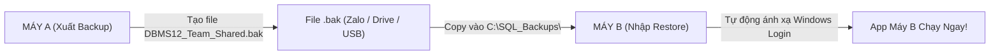

# HƯỚNG DẪN ĐỒNG BỘ CSDL GIỮA CÁC THÀNH VIÊN BẰNG FILE SAO LƯU (.BAK)

Tài liệu này hướng dẫn chi tiết quy trình chuyển toàn bộ dữ liệu và cấu trúc CSDL SQL Server từ **Máy A (Thành viên chia sẻ)** sang **Máy B (Thành viên nhận)** trong đồ án DBMS12 English Center.

---

## 📌 Tổng quan nguyên lý kỹ thuật

1. **Vấn đề đặc thù của dự án:**
   - Mỗi máy thành viên khi cài đặt sẽ có một tên Windows khác nhau (ví dụ: máy A là `CHARCAS`, máy B là `LAPTOP-AN`).
   - Ứng dụng Backend Web C# chạy dưới tài khoản dịch vụ non-admin: `[TENMAY\Dbms12Runtime]`.
   - Trong CSDL, tài khoản này được ánh xạ thành Database User `[Dbms12ProjectRuntime]`, thuộc Role bảo mật `[dbms12_runtime]`.
2. **Hệ quả khi Restore file `.bak` thông thường:**
   - Khi máy B restore file `.bak` từ máy A, trong CSDL máy B sẽ mang user `[Dbms12ProjectRuntime]` liên kết với Windows Login của máy A (`[CHARCAS\Dbms12Runtime]`).
   - Máy B không có tài khoản Windows này, dẫn đến hiện tượng **Orphaned User (Người dùng mồ côi)**. Khi chạy `Chay-Project.cmd`, ứng dụng sẽ văng lỗi *Login failed*.
3. **Giải pháp đã được tự động hóa trong bộ công cụ này:**
   - Sau khi Restore, script sẽ tự động tạo Windows Login cho máy B (`[TENMAY_B\Dbms12Runtime]`) và ánh xạ lại user `[Dbms12ProjectRuntime]` sang Login mới.
   - Ứng dụng trên máy B sẽ khởi chạy ngay lập tức mà không cần cấu hình thêm bất cứ điều gì!

---

## 🚀 QUY TRÌNH THỰC HIỆN (4 BƯỚC)



---

### BƯỚC 1: TRÊN MÁY A (Thành viên xuất dữ liệu)

> [!NOTE]
> Bạn có thể chọn 1 trong 2 cách dưới đây:

#### Cách 1.1: Click đúp chạy script tự động (Khuyên dùng)
1. Mở thư mục [`docs/study/dong_bo_database/`](file:///c:/Study/SOEN/main_workplace/DBMS12_EnglishCenter/docs/study/dong_bo_database/).
2. Nhấp đúp chuột vào file: **[`Xuat-Backup.cmd`](file:///c:/Study/SOEN/main_workplace/DBMS12_EnglishCenter/docs/study/dong_bo_database/Xuat-Backup.cmd)**.
3. Cửa sổ dòng lệnh sẽ tự động nhận diện Database hiện tại và tạo file sao lưu tại:
   `C:\SQL_Backups\DBMS12_Team_Shared.bak`.

#### Cách 1.2: Chạy bằng SQL Server Management Studio (SSMS)
1. Mở SSMS, kết nối vào SQL Server (`localhost\SQLEXPRESS`).
2. Mở file script: **[`1_XUAT_BACKUP_MAY_A.sql`](file:///c:/Study/SOEN/main_workplace/DBMS12_EnglishCenter/docs/study/dong_bo_database/1_XUAT_BACKUP_MAY_A.sql)**.
3. Nhấn **F5** (Execute). Kết quả báo `SAO LƯU THÀNH CÔNG!`.

---

### BƯỚC 2: CHUYỂN FILE CHO THÀNH VIÊN KHÁC
- Gửi file sao lưu `DBMS12_Team_Shared.bak` cho bạn trong nhóm qua Google Drive, Zalo, hoặc USB.
- **Thành viên nhận (Máy B):** Tải file về và lưu đúng vào đường dẫn:
  `C:\SQL_Backups\DBMS12_Team_Shared.bak`
  *(Nếu ổ C chưa có thư mục `SQL_Backups`, hãy tạo mới thư mục này).*

---

### BƯỚC 3: TRÊN MÁY B (Thành viên nhận dữ liệu)

> [!IMPORTANT]
> **Điều kiện tiên quyết trên Máy B:**
> Máy B phải đã clone source code từ GitHub về và đã chạy `./Chay-Project.cmd` ít nhất một lần để tạo khung môi trường (theo hướng dẫn `TEAM_QUICKSTART.md`). Đảm bảo tắt ứng dụng (nhấn Enter ở launcher) trước khi Restore.

#### Cách 3.1: Click đúp chạy script tự động (Khuyên dùng)
1. Mở thư mục [`docs/study/dong_bo_database/`](file:///c:/Study/SOEN/main_workplace/DBMS12_EnglishCenter/docs/study/dong_bo_database/).
2. Nhấp đúp chuột vào file: **[`Nhap-Restore.cmd`](file:///c:/Study/SOEN/main_workplace/DBMS12_EnglishCenter/docs/study/dong_bo_database/Nhap-Restore.cmd)**.
3. Script sẽ tự động:
   - Đọc tên Database của máy B từ file cấu hình.
   - Ngắt các kết nối cũ và khôi phục toàn bộ bảng, dữ liệu từ file `.bak`.
   - Lấy tên máy tính của máy B và ánh xạ lại quyền truy cập cho user `Dbms12Runtime`.
   - Chạy kiểm tra toàn vẹn `DBCC CHECKDB`.

#### Cách 3.2: Chạy bằng SQL Server Management Studio (SSMS)
1. Mở SSMS trên Máy B, kết nối vào `localhost\SQLEXPRESS`.
2. Mở file script: **[`2_NHAP_RESTORE_MAY_B.sql`](file:///c:/Study/SOEN/main_workplace/DBMS12_EnglishCenter/docs/study/dong_bo_database/2_NHAP_RESTORE_MAY_B.sql)**.
3. Nhấn **F5** (Execute). Toàn bộ quá trình phục hồi và cấp quyền sẽ tự động thực thi.

---

### BƯỚC 4: NGHIỆM THU TRÊN MÁY B
1. Trên Máy B, chạy lại file:
   [`Chay-Project.cmd`](file:///c:/Study/SOEN/main_workplace/DBMS12_EnglishCenter/Chay-Project.cmd)
2. Mở trình duyệt truy cập: `https://localhost:8446/dbms12`.
3. Kiểm tra các dữ liệu mới được Máy A nhập (danh sách học viên, hóa đơn, lớp học, điểm thi...) đều đã hiển thị đầy đủ và chính xác!

---

## 🛠️ XỬ LÝ CÁC TÌNH HUỐNG THƯỜNG GẶP

### 1. Lỗi: "Cannot open backup device ... Operating system error 3 (The system cannot find the path specified)"
- **Nguyên nhân:** Thư mục `C:\SQL_Backups\` chưa tồn tại trên máy tính.
- **Khắc phục:** Mở ổ C: tạo thư mục `SQL_Backups`, hoặc dùng PowerShell tạo:
  ```powershell
  New-Item -ItemType Directory -Path C:\SQL_Backups -Force
  ```

### 2. Lỗi: "Exclusive access could not be obtained because the database is in use"
- **Nguyên nhân:** Ứng dụng web hoặc query window nào đó trên SSMS đang kết nối vào Database.
- **Khắc phục:** Script `2_NHAP_RESTORE_MAY_B.sql` đã có sẵn lệnh `SET SINGLE_USER WITH ROLLBACK IMMEDIATE`. Nếu chạy thủ công, hãy đóng cửa sổ launcher `Chay-Project.cmd` trước khi Restore.

### 3. Máy B muốn kiểm tra lại người dùng mồ côi (Orphaned Users)
- Chạy câu lệnh kiểm tra trong SSMS:
  ```sql
  USE [Tên_Database_Máy_B];
  EXEC sp_change_users_login 'Report';
  ```
- Nếu danh sách rỗng (`0 rows`), toàn bộ người dùng và vai trò bảo mật đã được đồng bộ hoàn hảo!
