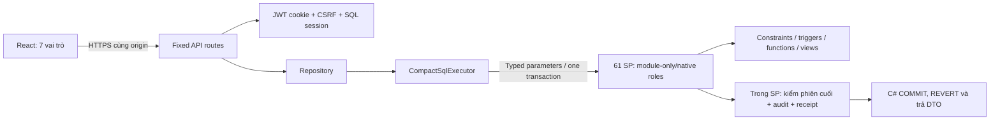

# Kiến trúc và đường đi code

## Backend: backend/EnglishCenter.Dbms12

|File|Trách nhiệm|
|---|---|
|Program.cs|Chỉ chạy các mode CLI được chỉ định; không tự chọn database mặc định|
|ProjectLayout.cs|Xác minh marker của project, đọc cấu hình máy; không hardcode đường dẫn project cha|
|AppProfile.cs|Guard prefix/ID/fileGUID/schema/native user, SQL TLS, certificate, khóa JWT riêng|
|OwnerProvision.cs|Owner tạo catalog mới, cài theo manifest, sinh tài khoản mẫu, tạo DB user/role và profile; receipt ngăn tự tạo lại sau lỗi|
|OwnerInspect.cs|CLI chỉ đọc metadata/DBCC đúng profile, không mở HTTP endpoint|
|Dbms12Host.cs|Loopback8446, middleware bảo mật, CSRF, static .local/web, endpoint metadata, redaction lỗi|
|Dbms12Identity.cs|Hash mật khẩu/JWT, đọc credential và ghi kết quả login có CAS; session, đổi mật khẩu và logout|
|Dbms12Routes.cs / RequestFields.cs|Map route cố định, whitelist JSON/query/TVP, UUID/digest từ server, DTO và CSV|
|Data/Dbms12Repository.cs|Mở connection riêng, kiểm profile, gọi executor; không DbContext|
|Data/CompactSqlExecutor.cs|Kiểm file SHA/type, transaction, xác thực role rồi EXECUTE AS user cố định; gọi SP, COMMIT/ROLLBACK và REVERT|
|Shared/ và Resources/|Crypto/time/error helpers và blocklist đã copy vào project; không tham chiếu source EnglishCenter.Api bên ngoài|

## Giao dịch

C# mở transaction bằng SQL. Caller lấy Course shared/exclusive lock trước các session/domain reads. SP yêu cầu @@TRANCOUNT=1 và tự xác định Actor từ SID/epoch; kiểm native role khớp phiên. SP command kiểm replay, kiểm phiên cuối và ghi audit/receipt/activity cùng transaction. Executor gọi COMMIT/ROLLBACK và luôn REVERT về runtime; kết nối không pooling. Khóa thô giúp giữ đúng nghiệp vụ với SQL dễ giải thích; chưa benchmark tải lớn.

Request cancellation áp dụng khi đọc/chạy SQL. Khi bắt đầu COMMIT, không dùng request token để ngắt commit và không ghi audit FAILURE giả nếu mất ACK. UI giữ trạng thái chưa rõ kết quả và tra cứu riêng.

## Frontend

App chỉ render Dbms12App. Shared shell, Button, Modal, Avatar và ảnh/font có license đều nằm trong frontend. api.ts giữ CSRF, AbortControllers và pending command trong RAM; Workspace.tsx tải projection theo menu; Teaching.tsx/Schedules.tsx xử lý roster/TVP/lịch. Không dùng localStorage cho credential.

Đường chạy hoàn chỉnh là launcher build frontend rồi host phục vụ static cùng origin. npm run dev chỉ là frontend preview nếu chưa cấu hình API proxy. Dependency khóa bằng packages.lock.json và package-lock.json; không tự thêm framework khi sửa nghiệp vụ.
